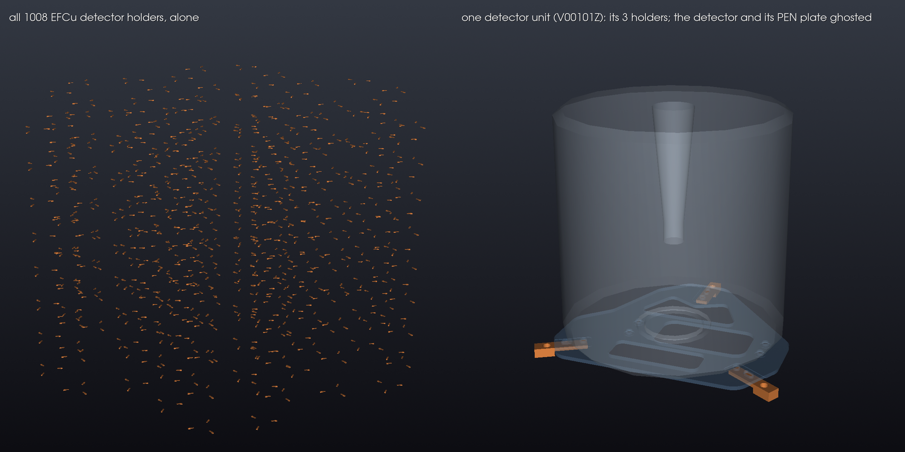
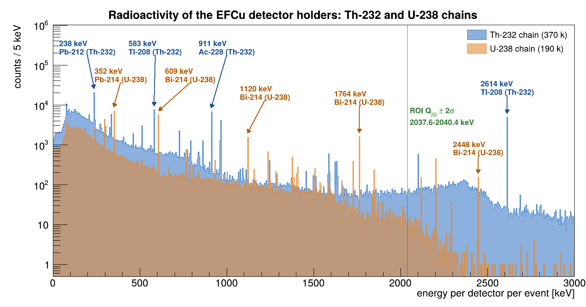
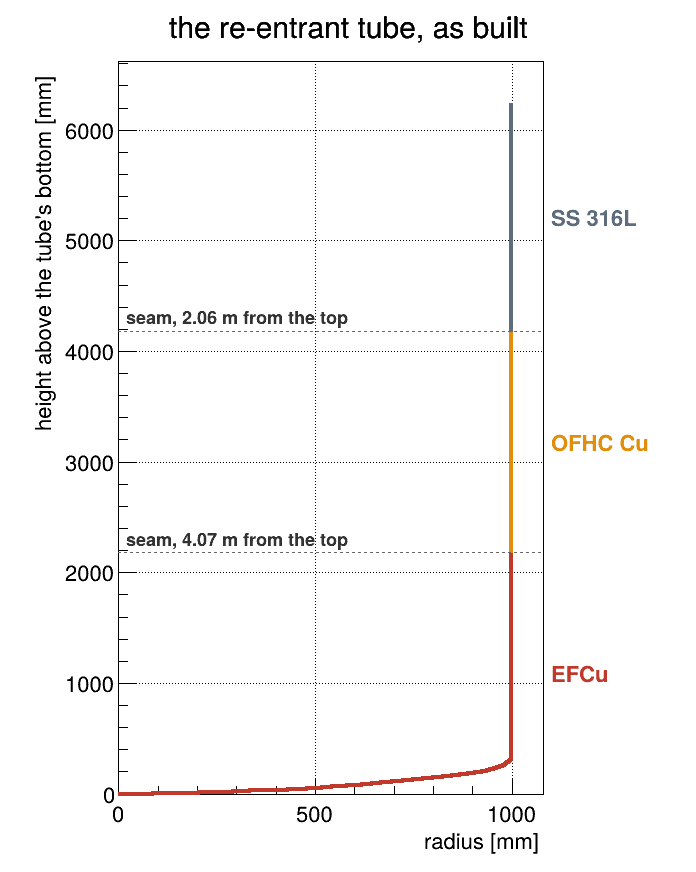
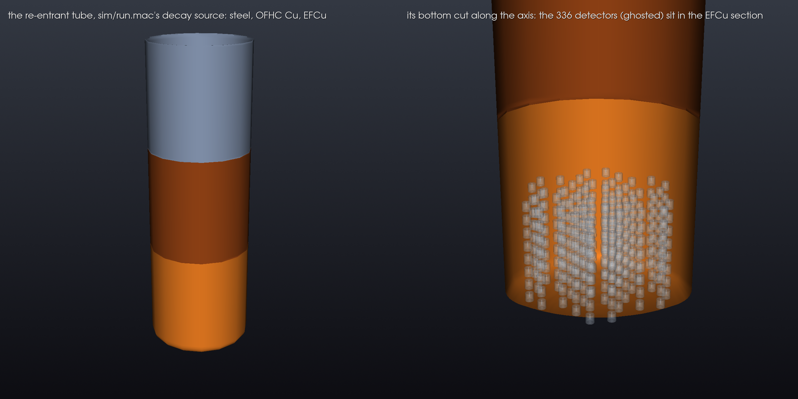
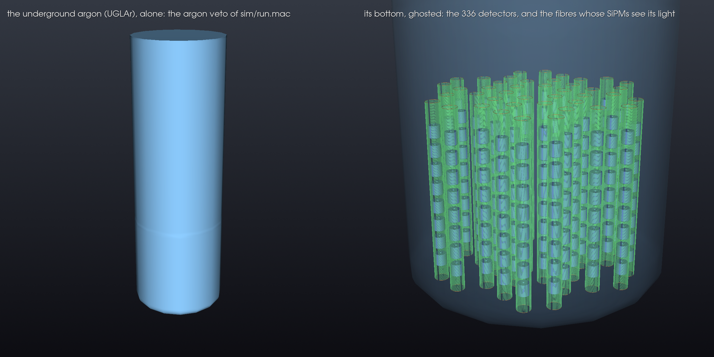
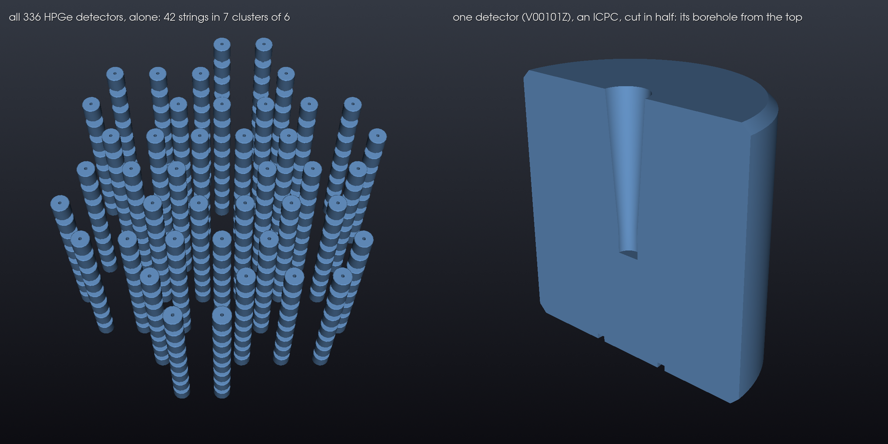
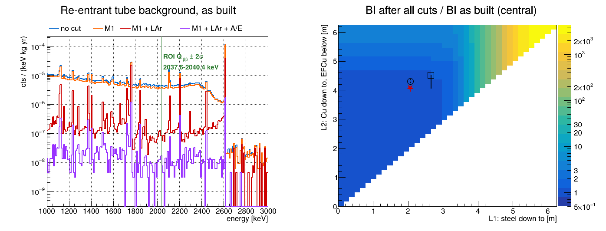

# LEGEND-1000 re-entrance tube

The re-entrance tube (RT) holds the underground argon (UGLAr) and the detector array. It is a 6m x 2m cylinder of steel
(SS) , OFHC copper (Cu) and electroformed copper (EFCu).

This study calculates the Background Index (BI) before and after cuts, and asks how much of the RT can be made cheaper (less EFCu, more SS) with its background rising at most 10% above the tube's as built.

| result                          |                                                                                                                                     |
| ------------------------------- | ----------------------------------------------------------------------------------------------------------------------------------- |
| as built                        | BI(before-cuts) = 4.60 × 10⁻⁶ cts/(keV·kg·yr), BI(after-cuts) = 1.11 ± 0.12 × 10⁻⁸. **Ratios: 619 : 672 : 175 kg = 42 : 46 : 12 %** |
| 0.23m less EFCu                 | BI +6%. **Ratios: 619 : 692 : 154 kg = 42 : 47 : 11 %**                                                                             |
| 0.43m less EFCu & 0.60m more SS | BI +8%. **Ratios: 800 : 507 : 137 kg = 55 : 35 : 10 %**                                                                             |
|                                 |

[how radioactive is EFCu?](#how-radioactive-is-efcu) · [Method](#method) ·
[Results](#results) · [Run](#run) · [NERSC](#nersc) · [Files](#files) ·
[Limits](#limits) · [Future work](#future-work) · [References](#references)

## how radioactive is EFCu?

what electroformed copper's own radioactivity looks like in the detectors.

`hpge_string_support_weldment_copper` The 1008 (1.92 kg) EFCu detector holders, clamping the PEN plate under the detector and holding it to support rods, are simulated with EFCu's Th-232 and U-238 chains.

lines threaten `Qββ`: **Tl-208 at 2614 keV** and
**Bi-214 at 2448 keV**, whose gammas can leave 2039 keV in a detector.

Th-chain: 370000 chains, 5005703 germanium steps -> 434263 detector events

U-chain: 190000 chains, 1960954 germanium steps -> 176339 detector events

- **Simulated** (`sim/holders.mac`): 370 k Th-232 and 190 k U-238 chains, the ratio of EFCu's activities (0.37 : 0.19 µBq/kg), so the two spectra add as counted.
- **The spectrum** (`ana/holders.C`): raw energy each of 336 detector gets per event

```bash
~/venvs/v/bin/python geom/l1000-autopeel.py --holders output/holders_geometry.png
```



```bash
remage -q --ignore-warnings -t 8 -w -o output/holders_th232.root -s GDML=geom/l1000.gdml -s Z=90 -s A=232 -s NEV=370000 -s SEED=21 -- sim/holders.mac
remage -q --ignore-warnings -t 8 -w -o output/holders_u238.root -s GDML=geom/l1000.gdml -s Z=92 -s A=238 -s NEV=190000 -s SEED=22 -- sim/holders.mac
root -l -b -q ana/holders.C
```



## Method

### 1. The geometry

The full LEGEND-1000 geometry v0.6, `geom/l1000.gdml`

The tube is 6.246 m tall and 0.999 m in radius; the 336 detectors sit 4.8-5.9 m below its top, inside the
EFCu section. Walls: EFCu 1.5 mm (2.1 mm at the Cu seam), Cu and SS 6 mm; `ana/background.C` reads and checks it,
and its printout opens with it as TUBE: the outline, the seams at z = 920 and 2925 mm (4.07 m and 2.06 m below
the top, the depths a design moves), the wall thicknesses, the densities and the germanium mass:

```
TUBE  read from geom/l1000.gdml: z -1259.0 .. 4987.0 mm (6.246 m), 182 outline points, seams EFCu | 920.0 | Cu | 2925.0 | SS
    clean surface: on-axis points 2 (expect 2), duplicates 0, spikes 0, self-intersections 0 (expect 0)
    endcap: radius 999.0000 at z -946.6, barrel 999.0000: step +0.0000 mm
    shells against the barrel: Cu -0.0000, SS -0.0000 mm
    wall thickness [mm]:  EFCu 1.50 (z -947)  EFCu 1.50 (z -13)  EFCu 2.10 (z 910)  Cu 6.00 (z 1922)  SS 6.00 (z 3956)
    densities [kg/m^3], the GDML's: SS 8000, Cu 8960, EFCu 8960
    germanium, the GDML's: 336 detectors, 1023.4 kg: the BI is per kg of it
    tube: PASS
```



The tube's three sections are the decay sources (SS : Cu : EFCu = 619.4 : 671.7 : 174.6 kg). The

underground argon around the detectors (18.83 m³, 26.17 t) is the veto, its light read by 12096 fibres and
252 SiPMs.

Each detector is an ICPC, 90.0 mm tall and 88.8 mm across, its borehole 53 mm deep from the
top: 3.046 kg, 1023.4 kg in all.


### 2. From sources to a BI

**Simulation** (`sim/run.mac`, remage). One nuclide decays uniformly in the tube wall: **Tl-208**
(²³²Th chain) or **Bi-214** (²³⁸U chain), the only chain members whose gammas reach `Qββ`. It records the
energy each decay leaves in each detector and in the UGLAr.

**Detector response** (`sim/hit.py`, reboost 1.4): in the germanium the energy through the dead
layer, the resolution and the A/E classifier; in the UGLAr the photoelectrons the SiPMs see, from the
optical map.

**Cuts** (`ana/background.C`), in LEGEND's order: **M1** (exactly one detector above 25 keV), the
**LAr veto** (< 4 photoelectrons), **A/E** (single-site-like, at the value that keeps 90% of the Tl-208
double-escape peak).

**BI** is MAJORANA's 360 keV window around `Qββ` [[1]](#references) [[2]](#references), per keV,
per kg of germanium (1023.4 kg), per year. Each decay is weighted by the activity of the material at its
depth (see Normalisation), so one simulation serves every SS / Cu / EFCu design.

**Normalisation**: turns simulated decays into real ones. Per section, from the GDML and the activities:
M = ρV, A = M × a (a: the chain's µBq/kg × the nuclide's share of it), N_real = A × 1 yr. The simulation put
N_sim decays there, so each stands for N_real / N_sim real decays a year. A window event adds that weight
/ (1023.4 kg × 360 keV) to the BI. The weight depends only on the material at the decay's depth, so a design
swaps ρ·a there, with no new simulation.

The printout's DECAYS part, per chain: where the decays fell, the germanium hits after each cut (all, then in
the window), and the normalisation (`simulated` is N_sim, `weight` is N_real / N_sim):

```
DECAYS  Tl208  (output/tl208*_hit.root, 125680279 decays, 15 files)
    where they decayed: EFCu 18.3%, Cu 40.9%, SS 40.8%; in the argon 0, outside the tube 0
    germanium hits: 1477398, after M1 1261435, + LAr veto 31109, + A/E 4330; of these in the window: 48973, 41447, 494, 86
    LAr veto keeps 1 in 41 M1 hits; read off the optical map alone, without the argon beyond its edge, 1 in 14
    the normalisation, per section: volume, mass, activity, simulated decays (and per m^3), weight = real decays a year per simulated one
    section   V [m^3]   M [kg]     A [Bq]  simulated     per m^3   weight
    EFCu      0.01948    174.6  2.322e-05   23040358  1182487533 3.18e-05
    Cu        0.07497    671.7  2.656e-04   51383783   685374882 0.000163
    SS        0.07742    619.4  2.226e-01   51256138   662015579    0.137
    the runs sampled the EFCu 1.755 x as densely as the shells (1 = evenly): each section's weight uses its own density

DECAYS  Bi214  (output/bi214*_hit.root, 635672115 decays, 66 files)
    where they decayed: EFCu 3.6%, Cu 47.4%, SS 49.0%; in the argon 0, outside the tube 0
    germanium hits: 763353, after M1 685024, + LAr veto 31387, + A/E 4346; of these in the window: 2350, 2185, 488, 21
    LAr veto keeps 1 in 22 M1 hits; read off the optical map alone, without the argon beyond its edge, 1 in 10
    the normalisation, per section: volume, mass, activity, simulated decays (and per m^3), weight = real decays a year per simulated one
    section   V [m^3]   M [kg]     A [Bq]  simulated     per m^3   weight
    EFCu      0.01948    174.6  3.317e-05   23030232  1181967842 4.55e-05
    Cu        0.07497    671.7  8.733e-04  301384853  4019976653 9.14e-05
    SS        0.07742    619.4  1.548e+00  311257030  4020142973    0.157
    the runs sampled the EFCu 0.294 x as densely as the shells (1 = evenly): each section's weight uses its own density
```

### 3. Inputs

**Activities µBq/kg** (`cfg::chain` in `ana/background.C`), from Ralph's MaterialMix [[3]](#references).
Bi-214 is 100% of the ²³⁸U chain; Tl-208 35.94% of the ²³²Th chain [[8]](#references)

|      | ²³²Th chain | ²³⁸U chain | source quoted there               |
| ---- | ----------- | ---------- | --------------------------------- |
| SS   | 1000        | 2500       | Bernhard                          |
| Cu   | 1.1         | 1.3        | MAJORANA assay [[4]](#references) |
| EFCu | 0.37        | 0.19       | M. Green                          |

`ana/background.C` prints the window, cuts and activities it uses as INPUTS:

```
INPUTS  window: 1950-2350 keV minus 10 keV around 2039, 2103.5, 2118.5, 2204.1 keV (MAJORANA's BEW): 360 keV
        cuts: M1 (exactly one detector above 25 keV), LAr veto (the SiPMs see < 4 photoelectrons), A/E classifier > -1.10 (90% DEP, A/E CUT)
        activity: chain [uBq/kg] 232Th / 238U: SS 1000 / 2500, Cu 1.1 / 1.3, EFCu 0.37 / 0.19; Tl208 is 35.94% of 232Th, Bi214 100% of 238U
```

**Detector response**, from (legend1000-metadata `simprod/config`,
experiment `l1000dsg01`) [[6]](#references), applied with reboost [[7]](#references). every detector is the dummy `V99999Z`, with the drift times of `V00000A`, which has its geometry.

|                | value                                                                                            | from                                                         |
| -------------- | ------------------------------------------------------------------------------------------------ | ------------------------------------------------------------ |
| dead layer     | FCCD 0.7 mm, outer half fully dead, linear in between                                            | `V99999Z`; `tier/hit` `dead_layer_fraction` 0.5              |
| resolution     | FWHM = √(0.5 + 0.001·E) keV: 1.59 keV at `Qββ`                                                   | `pars/geds/eresmod`                                          |
| A/E            | A: max of one template current pulse per step, at its drift time; σ_A/E = 0.01                   | `pars/geds/currmod`, `aoeresmod`; `output/dtmap_V00000A.lh5` |
| photoelectrons | LAr scintillation × the summed optical map; σ 0.3 PE, 16 ns merging, ≤ 100 PE per hit            | `/all` of the optical map; `tier/opt`                        |
| M1, LAr veto   | one detector above 25 keV; rejects ≥ 4 PE summed                                                 | `tier/evt`                                                   |
| A/E cut        | classifier > −1.10, tuned to keep 90% of the Tl-208 DEP; the production's −1.5 keeps 91%         | LEGEND's convention                                          |

- **A/E** is the amplitude of the current-pulse over the energy. A gamma that scatters several times
  in the crystal spreads its charge out in time, giving a broad, low pulse: A/E << 1.
  0νββ puts its energy (2e-) in one spot: A/E ≈ 1. The cut removes events with low
  A/E, and LEGEND places it so that 90% of the Tl-208 double-escape peak (1592.5 keV, single-site) survives.
  The printout's A/E CUT part: the DEP it is tuned on, and what the cut keeps of each Tl-208 peak and of the
  window, next to `V00000A`'s measurement at HADES:

  ```
  A/E CUT  tuned on the Tl208 DEP (1592.5 keV) in M1 hits: 1000 in +-2.5 keV, 1026 in the sidebands 5-10 keV off it, 487 net
      classifier > -1.10 keeps 90% of it (+- 1% statistics); the production's > -1.50 kept 91%
      kept by it, net of the continuum:  DEP 1592.5 0.90 (487 net)  SEP 2103.5 0.02 (2798 net)  FEP 2614.5 0.04 (35540 net)  window 0.26 (41447)
      measured on V00000A at HADES:       DEP 1592.5 0.90            SEP 2103.5 0.04            FEP 2614.5 0.06            window 0.27
  ```
- **Optical map** (M. Neuberger [[5]](#references)): for every 5 mm cell of the UGLAr, the probability that a
  scintillation photon made there reaches a SiPM. `sim/hit.py` turns each argon deposit into photons,
  and these into photoelectrons with that probability; the LAr veto counts them.

### 4. Judging a design

A designs BI is the as-built's plus the change. Too few events survive all cuts far from the detectors to count the change on
them, so it is counted on the window events that pass M1, 100-500 times more, times the **cut survival**: the fraction of
them that also pass the LAr veto and A/E (window events after all cuts / after M1). It is measured where the change is:

- near the detectors (below 4.37 m), per chain: 2.0 × 10⁻³ (Tl-208), 9.9 × 10⁻³ (Bi-214);
- higher up, both chains together: 4 of 662 = 6.0 × 10⁻³ (90% bound 1.2 × 10⁻²). Tl-208's events survive
  ~3 × more often there, partly because the optical map gives no light above z = 1.375 m.

Both come from the printout's DEPTH part, per chain and 0.62 m slab below the tube's top: near, the rows below
4.37 m summed; higher up, the rows above summed over both chains (Tl-208 2 + 41 + 566, Bi-214 8 + 45 = 662
events after M1, 4 after all cuts):

```
DEPTH  Tl208  by depth below the tube's top: decays, germanium hits per decay, window events after M1 and after all cuts,
       and the cut survival = window events after all cuts / after M1
    depth [m]            decays   hits/decay   window: M1   all cuts   survival
     0.00..0.62       15527714     0.00e+00            0          0      -
     0.62..1.25       15520616     0.00e+00            0          0      -
     1.25..1.87       15528133     0.00e+00            0          0      -
     1.87..2.50       15896343     6.29e-08            0          0      -
     2.50..3.12       16043166     3.43e-06            2          0 0.0000
     3.12..3.75       16051397     8.74e-05           41          2 0.0488
     3.75..4.37       11560446     1.74e-03          566          2 0.0035
     4.37..5.00        6949906     4.53e-02         8960         19 0.0021
     5.00..5.62        6947684     1.07e-01        20651         45 0.0022
     5.62..6.25        5654874     6.98e-02        11227         18 0.0016   <- nearest the detectors

DEPTH  Bi214  by depth below the tube's top: decays, germanium hits per decay, window events after M1 and after all cuts,
       and the cut survival = window events after all cuts / after M1
    depth [m]            decays   hits/decay   window: M1   all cuts   survival
     0.00..0.62       94273410     0.00e+00            0          0      -
     0.62..1.25       94293221     0.00e+00            0          0      -
     1.25..1.87       94290361     0.00e+00            0          0      -
     1.87..2.50       94371578     2.12e-08            0          0      -
     2.50..3.12       94424017     3.71e-07            0          0      -
     3.12..3.75       94410451     1.40e-05            8          0 0.0000
     3.75..4.37       50064866     2.51e-04           45          0 0.0000
     4.37..5.00        6943838     2.28e-02          454          5 0.0110
     5.00..5.62        6943493     5.59e-02         1099         10 0.0091
     5.62..6.25        5656880     3.59e-02          579          6 0.0104   <- nearest the detectors
```

The 90% bound on the change adds, per chain, per change (Cu or EFCu to SS, EFCu to Cu) and per region,
the Poisson limit on its M1 events (2.3 if none) × the cut survival × the largest weight change there. A depth range
with no event still costs its bound, so more SS can only be shown where the simulation has enough
decays. A design passes when the bound is at most 10% of the BI as built (`cfg::simTol`); the central value
is shown too.

## Results

761 M tube decays = Tl-208 / Bi-214 --> 2.9M / 2.9M whole tube, 22.8M / 22.8M EFCu, 50M / 300M Cu, 50M / 310M SS;

After all cuts: 107
window events (±11%), 104 from the EFCu (83 Tl-208, 21 Bi-214), 3 from the Cu, none from the SS.

**The BI as-built: (10⁻⁵ budget)**

|     | no cut                   | M1                                   | M1 + LAr                                                 | all (M1+LAr+A/E)                                                |
| --- | ------------------------ | ------------------------------------ | -------------------------------------------------------- | --------------------------------------------------------------- |
|     | 4.60 × 10⁻⁶ (46% budget) | 3.92 × 10⁻⁶ (39% budget) removes 15% | 1.14 ± 0.04 × 10⁻⁷ (1% budget) LAr vetos 97% of the rest | **1.11 ± 0.12 × 10⁻⁸ (0.1% budget)** A/E is 90% of what is left |

The printout's BI AS BUILT part, per chain and section; `win hits` counts the window events at each cut level
(no cut / M1 / + LAr / + A/E):

```
BI AS BUILT  [cts/(keV kg yr)], +- simulation statistics; a section with no window event gets its 90% limit, 2.30 x its heaviest decay
    chain  sect          win hits   no cut                 M1                     M1 + LAr               M1 + LAr + A/E
    Tl208  SS             0/0/0/0   < 8.56e-07 (90%)       < 8.56e-07 (90%)       < 8.56e-07 (90%)       < 8.56e-07 (90%)
           Cu        222/202/26/3   9.83e-08 +- 6.6e-09    8.94e-08 +- 6.3e-09    1.15e-08 +- 2.3e-09    1.33e-09 +- 7.7e-10
           EFCu   48751/41245/468/83   4.21e-06 +- 1.9e-08    3.56e-06 +- 1.8e-08    4.04e-08 +- 1.9e-09    7.16e-09 +- 7.9e-10
           tube                     4.31e-06 +- 2.0e-08    3.65e-06 +- 1.9e-08    5.19e-08 +- 2.9e-09    8.49e-09 +- 1.1e-09
    Bi214  SS             0/0/0/0   < 9.80e-07 (90%)       < 9.80e-07 (90%)       < 9.80e-07 (90%)       < 9.80e-07 (90%)
           Cu          40/38/12/0   9.93e-09 +- 1.6e-09    9.43e-09 +- 1.5e-09    2.98e-09 +- 8.6e-10    < 1.94e-09 (90%)
           EFCu   2310/2147/476/21   2.85e-07 +- 5.9e-09    2.65e-07 +- 5.7e-09    5.87e-08 +- 2.7e-09    2.59e-09 +- 5.7e-10
           tube                     2.95e-07 +- 6.1e-09    2.74e-07 +- 5.9e-09    6.17e-08 +- 2.8e-09    2.59e-09 +- 5.7e-10
    ALL CHAINS
      no cut           4.60e-06 +- 2.1e-08 (0.46 x goal)
      M1               3.92e-06 +- 2.0e-08 (0.39 x goal)
      M1 + LAr         1.14e-07 +- 4.1e-09 (0.011 x goal)
      M1 + LAr + A/E   1.11e-08 +- 1.2e-09 (0.0011 x goal)
    ...with the LAr veto read off the optical map alone, no light from the argon beyond its edge:
      M1 + LAr         2.79e-07 +- 5.7e-09 (0.028 x goal)
      M1 + LAr + A/E   3.28e-08 +- 1.9e-09 (0.0033 x goal)
    win hits: per cut level, as in the columns. sections with no window hit are left out of the totals
```

**The designs:**

| EFCu from (`L2`)  | EFCu       | at 90%: SS to | SS : Cu : EFCu         | BI rise | central: SS to | SS : Cu : EFCu         | BI rise |
| ----------------- | ---------- | ------------- | ---------------------- | ------- | -------------- | ---------------------- | ------- |
| 4.07 m, as built  | 175 kg     | 2.06 m        | 619 : 672 : 175 kg     | 0%      | 2.66 m         | 800 : 470 : 175 kg     | 0%      |
| 4.20 m            | 163 kg     | 2.06 m        | 619 : 684 : 163 kg     | 3%      | 2.66 m         | 800 : 482 : 163 kg     | 1%      |
| **4.30 m**        | **154 kg** | **2.06 m**    | **619 : 692 : 154 kg** | **6%**  | 2.66 m         | 800 : 490 : 154 kg     | 3%      |
| **4.50 m**        | **137 kg** | fails         |                        |         | **2.66 m**     | **800 : 507 : 137 kg** | **8%**  |
| 4.60 m and deeper | ≤ 129 kg   | fails         |                        |         | fails          |                        |         |

The printout's DESIGNS part: for each depth `L2` where the EFCu starts, the deepest `L1` where the SS can end and
still pass; its last lines are the decays SS still needs ([How many decays](#nersc)):

```
DESIGNS  against the tube as built (BI 1.11e-08 after all cuts): SS down to L1, Cu down to L2, EFCu below. a design passes when its BI
    rises by at most 10%: at 90% confidence (bound), or on the central value (central). L1 from 2.06 m down, 1 cm at a time
    a design's change is counted on window events after M1 x the cut survival (see DEPTH): below 4.37 m Tl208 2.01e-03 Bi214 9.85e-03; above it, both chains, 4 of 662 = 6.04e-03 (90% bound 1.21e-02)
    L2 [m]   EFCu | bound: L1 SS : Cu : EFCu                         rise | central L1 SS : Cu : EFCu                         rise
    4.07   175 kg |    2.06 m  619 : 672 : 175 kg = 42 : 46 : 12 %      +0% |    2.66 m  800 : 470 : 175 kg = 55 : 33 : 12 %      +0%   <- EFCu as built
    4.10   171 kg |    2.06 m  619 : 675 : 171 kg = 42 : 46 : 12 %      +1% |    2.66 m  800 : 473 : 171 kg = 55 : 33 : 12 %      +0%
    4.20   163 kg |    2.06 m  619 : 684 : 163 kg = 42 : 47 : 11 %      +3% |    2.66 m  800 : 482 : 163 kg = 55 : 33 : 11 %      +1%
    4.30   154 kg |    2.06 m  619 : 692 : 154 kg = 42 : 47 : 11 %      +6% |    2.66 m  800 : 490 : 154 kg = 55 : 34 : 11 %      +3%
    4.40   146 kg | -         rises too much at any L1                    |    2.66 m  800 : 499 : 146 kg = 55 : 35 : 10 %      +5%
    4.50   137 kg | -         rises too much at any L1                    |    2.66 m  800 : 507 : 137 kg = 55 : 35 : 10 %      +8%
    4.60   129 kg | -         rises too much at any L1                    | -         rises too much at any L1
    4.70   121 kg | -         rises too much at any L1                    | -         rises too much at any L1
    4.80   112 kg | -         rises too much at any L1                    | -         rises too much at any L1
    4.90   104 kg | -         rises too much at any L1                    | -         rises too much at any L1
    5.00    95 kg | -         rises too much at any L1                    | -         rises too much at any L1
    5.25    74 kg | -         rises too much at any L1                    | -         rises too much at any L1
    5.50    53 kg | -         rises too much at any L1                    | -         rises too much at any L1
    5.75    32 kg | -         rises too much at any L1                    | -         rises too much at any L1
    6.00    11 kg | -         rises too much at any L1                    | -         rises too much at any L1
    least EFCu, then most SS, at 90% confidence: L2 4.30 m, L1 2.06 m:  619 : 692 : 154 kg = 42 : 47 : 11 %
    least EFCu, then most SS, on the central value: L2 4.50 m, L1 2.66 m:  800 : 507 : 137 kg = 55 : 35 : 10 %
    as built:  619 : 672 : 175 kg = 42 : 46 : 12 %. rise: over the BI as built, the 90% bound on the change (bound) or the change itself (central)
    a depth range with no window event after M1 still bounds what SS there would add, at 2.30 x the cut survival x its weight;
    the decays that bring that bound under 5% of the BI as built, per chain:
      Tl208  SS added in the Cu section       51383783 decays now: bound    45%; 4.6e+08 decays would bring it to 5%
      Tl208  the SS as built                  51256138 decays now: bound    47%; 4.8e+08 decays would bring it to 5%
      Bi214  SS added in the Cu section      301384853 decays now: bound    53%; 3.2e+09 decays would bring it to 5%
      Bi214  the SS as built                 311257030 decays now: bound    53%; 3.3e+09 decays would bring it to 5%
```

- **EFCu** can start 23 cm lower, at 4.30 m (154 kg, −12%), shown at 90%; on the central value at 4.50 m
  (137 kg, −22%). Below that the Cu next to the detectors, at 3-7 × EFCu's activity, adds too much at any
  SS seam.
- **SS** reaches 2.66 m on the central value only because no decay between 2.06 and 2.66 m put an event
  in the window, in either chain. That is the statistics' silence, not a measurement: at 90% each empty slab
  still allows +45% (Tl-208) and +53% (Bi-214), so no extra SS is shown yet. Below 2.66 m the first
  events appear, and each costs ~20% of the BI.
- **The reference itself** has the same gap: the SS as built is bounded only at +47% and +53% per chain.



Left: the tube's spectrum as built through every cut, the ROI shaded green. Right: every design's BI over
the tube's as built, on the central value (star: as built; circle: the design shown at 90%; square: the
central-value design; lines: the deepest passing SS, solid central, dashed 90%).

## Run

```bash
rsync -a --partial nersc:/global/cfs/cdirs/m2676/users/neuberger/L1000_optical_muon_sims/omaps/v0.4.0/ular/merged/merged_optmap_20260225_063750.lh5 output/
rsync -a nersc:/global/cfs/cdirs/m2676/users/neuberger/L1000_optical_muon_sims/hpge_related/dtmaps/gen/V00000A.lh5 output/dtmap_V00000A.lh5
```

```bash
export G=geom/l1000.gdml
remage -q --ignore-warnings -t 8 -w -m -o output/tl208.lh5 -s GDML=$G -s Z=81 -s A=208 -s NEV=1000000 -s SEED=1 -s VOLS='reentrance_tube_.*' -- sim/run.mac
remage -q --ignore-warnings -t 8 -w -m -o output/tl208_2.lh5 -s GDML=$G -s Z=81 -s A=208 -s NEV=2000000 -s SEED=3 -s VOLS='reentrance_tube_.*' -- sim/run.mac
remage -q --ignore-warnings -t 8 -w -m -o output/bi214.lh5 -s GDML=$G -s Z=83 -s A=214 -s NEV=1000000 -s SEED=2 -s VOLS='reentrance_tube_.*' -- sim/run.mac
remage -q --ignore-warnings -t 8 -w -m -o output/bi214_2.lh5 -s GDML=$G -s Z=83 -s A=214 -s NEV=2000000 -s SEED=4 -s VOLS='reentrance_tube_.*' -- sim/run.mac
~/venvs/v/bin/python sim/hit.py output/tl208*.lh5 output/bi214*.lh5
root -l -b -q ana/background.C
~/venvs/v/bin/python geom/l1000-autopeel.py --tube output/tube_geometry.png
~/venvs/v/bin/python geom/l1000-autopeel.py --uglar output/uglar_geometry.png
~/venvs/v/bin/python geom/l1000-autopeel.py --hpge output/hpge_geometry.png
```

With a new optical map, no new simulation: only the response and the analysis rerun.

```bash
~/venvs/v/bin/python sim/hit.py --optmap output/<new map>.lh5 output/tl208*.lh5 output/bi214*.lh5
root -l -b -q ana/background.C
```

### NERSC

```bash
ssh nersc 'mkdir -p $SCRATCH/LEGEND1000-Simulation/sim $SCRATCH/LEGEND1000-Simulation/geom $SCRATCH/LEGEND1000-Simulation/output'
rsync -a geom/l1000.gdml nersc:'$SCRATCH/LEGEND1000-Simulation/geom/'
rsync -a sim/run.mac nersc:'$SCRATCH/LEGEND1000-Simulation/sim/'
ssh nersc 'shifterimg pull docker:legendexp/remage:v1.1.0'
ssh nersc 'cd $SCRATCH/LEGEND1000-Simulation && sbatch --account=m2676 --qos=debug --constraint=cpu --nodes=1 --time=00:30:00 --output=output/rt_test.log --image=docker:legendexp/remage:v1.1.0 --job-name=rt_test --wrap "shifter --module=none remage -q --ignore-warnings -t 32 -w -m -s GDML=geom/l1000.gdml -s NEV=20000 -s SEED=9999 -o output/rt_test.lh5 -s Z=81 -s A=208 -s VOLS=reentrance_tube_copper -- sim/run.mac"'
```

```bash
ssh nersc 'cd $SCRATCH/LEGEND1000-Simulation && sbatch --account=m2676 --qos=shared --constraint=cpu --cpus-per-task=32 --time=<TIME> --output=output/%x_%a.log --image=docker:legendexp/remage:v1.1.0 --array=<SEEDS> --job-name=<NAME> --wrap "shifter --module=none remage -q --ignore-warnings -t 32 -w -m -s GDML=geom/l1000.gdml -s NEV=10000000 -s SEED=\$SLURM_ARRAY_TASK_ID -o output/<NUCLIDE>_\$SLURM_ARRAY_TASK_ID.lh5 -s Z=<Z> -s A=<A> -s VOLS=<VOLS> -- sim/run.mac"'
```

| jobs | `<SEEDS>`             | `<NAME>`                          | `<NUCLIDE>` `<Z>` `<A>`     | `<VOLS>`                            | `<TIME>` |
| ---- | --------------------- | --------------------------------- | --------------------------- | ----------------------------------- | -------- |
| A    | 7001-7003 / 8001-8003 | `rt_tl208_efcu` / `rt_bi214_efcu` | tl208 81 208 / bi214 83 214 | `reentrance_tube_copper` (EFCu)     | 06:00:00 |
| B    | 3001-3005 / 4001-4031 | `rt_tl208_ss` / `rt_bi214_ss`     | the same                    | `reentrance_tube_layer_steel_316L`  | 04:00:00 |
| C    | 5001-5005 / 6001-6030 | `rt_tl208_cu` / `rt_bi214_cu`     | the same                    | `reentrance_tube_layer_copper_ofhc` | 04:00:00 |
| D    | 5006-5046 / 6031-6320 | `rt_tl208_cu2` / `rt_bi214_cu2`   | the same                    | `reentrance_tube_layer_copper_ofhc` | 01:00:00 |
| E    | 3006-3067 / 4032-4470 | `rt_tl208_ss2` / `rt_bi214_ss2`   | the same                    | `reentrance_tube_layer_steel_316L`  | 01:00:00 |

**How many decays.** A section's BI has a statistical error of 1/√(window events); with none it is only
bounded, at 2.3 events × its weight, and the weight falls as 1/N_sim. So N_sim is set by the precision needed:

- A (EFCu): the BI after all cuts from 4 window events (±50%) to ~100 (±10%): ~23 M per chain.
- B, C (SS, Cu): an empty section bounded at 10% of the 10⁻⁵ goal, the pass line then: 50 M Tl-208, 300 M Bi-214.
- D, E: an empty depth range bounded at 5% of the as-built BI per chain, on M1 window events × the cut survival (§4):
  N = N_now × 2.3 × survival × weight / (0.05 BI), N_now the section's decays so far, printed at the end of
  DESIGNS (Results). D was sized with the survival above 4.37 m at 4 / 662.
  Redone on 11 Oct with half of D in: survival 19 / 2405, BI 1.04 × 10⁻⁸, so Cu needs 6.5 × 10⁸ Tl-208 and
  4.5 × 10⁹ Bi-214 (D brings 4.6 × 10⁸ and 3.2 × 10⁹); SS 6.7 × 10⁸ and 4.7 × 10⁹: E.

**Seeds.** `SEED` starts remage's random numbers: the same seed repeats the same decays, so every run has its own.
It is also the run's number: in its file name (`tl208_<SEED>.lh5`) and, on NERSC, its job-array task
(`--array=7001-7003`: three runs, seeds 7001-7003).

| `SEED`      | runs                                               |
| ----------- | -------------------------------------------------- |
| 1-4         | laptop, whole tube: Tl-208 1 and 3, Bi-214 2 and 4 |
| 21, 22      | holders: Th-232, U-238                             |
| 3xxx / 4xxx | SS section: Tl-208 / Bi-214                        |
| 5xxx / 6xxx | Cu section: Tl-208 / Bi-214                        |
| 7xxx / 8xxx | EFCu section: Tl-208 / Bi-214                      |
| 9999        | the NERSC test                                     |

`sim/hit.py --seed` (default 1) is a different seed: with each file's name it starts the response's own random
numbers (energy smearing, photons, photoelectrons), so a file always gives the same hits.

```bash
ssh nersc 'squeue --me'
ssh nersc 'sacct -X -S today --format=JobID%18,JobName%16,State,Elapsed'
ssh nersc 'scancel -u $USER'
rsync -a --include='*_[0-9][0-9][0-9][0-9].lh5' --exclude='*' nersc:'$SCRATCH/LEGEND1000-Simulation/output/' output/
ssh nersc 'rm -r $SCRATCH/LEGEND1000-Simulation'
```

## Files

| source                             |                                                                                                                                                                                                                                                                                                            |
| ---------------------------------- | ---------------------------------------------------------------------------------------------------------------------------------------------------------------------------------------------------------------------------------------------------------------------------------------------------------- |
| `sim/run.mac`                      | the tube simulation; `-s` aliases `GDML`, `Z` `A` (Tl-208: 81 208, Bi-214: 83 214), `NEV`, `SEED`, and `VOLS`, a regex over the source volumes: `reentrance_tube_.*` (whole tube) or one section, `reentrance_tube_copper` (EFCu), `reentrance_tube_layer_copper_ofhc`, `reentrance_tube_layer_steel_316L` |
| `sim/hit.py`                       | the detector response; takes remage outputs, plus `--optmap`, `--dtmap`, `--metadata`, `--gdml`, `--seed` (defaults: the inputs below, seed 1)                                                                                                                                                             |
| `ana/background.C`                 | the analysis and its figures; takes the tube runs (`file=isotope`, wildcards merge files) and the GDML; the cuts, activities and pass line are in `cfg` (`m1_keV`, `lar_pe`, `depKeep`, `chain`, `simTol`)                                                                                                 |
| `sim/holders.mac`, `ana/holders.C` | the [proof of concept](#how-radioactive-is-efcu): whole chains in the holders; their spectrum                                                                                                                                                                                                              |
| `geom/l1000-autopeel.py`           | the geometry viewer; `--holders`, `--tube`, `--uglar`, `--hpge <png>` draw one part alone, offscreen, and print its numbers                                                                                                                                                                                |

| input                                      |                                                                                                                                                                    |
| ------------------------------------------ | ------------------------------------------------------------------------------------------------------------------------------------------------------------------ |
| `geom/l1000.gdml`                          | the geometry, legend-pygeom-l1000 0.6.0                                                                                                                            |
| `~/Documents/legend1000-metadata`          | the detectors and response parameters (`simprod/config`)                                                                                                           |
| `output/merged_optmap_20260225_063750.lh5` | the UGLAr optical map v0.4.0; its `/all` group, every SiPM summed                                                                                                  |
| `output/dtmap_V00000A.lh5`                 | the drift-time maps of `V00000A` (3500 V, ⟨100⟩ and ⟨110⟩ axes): how long each step's charge takes to reach the contact, which shapes the current pulse and so A/E |

| output (`output/`)                        | from                                      | holds                                                                                                                                                                                                                                                                    |
| ----------------------------------------- | ----------------------------------------- | ------------------------------------------------------------------------------------------------------------------------------------------------------------------------------------------------------------------------------------------------------------------------ |
| `tl208*.lh5`, `bi214*.lh5`                | `sim/run.mac`                             | `stp/` (336 germanium tables and `liquid_argon_underground`), `vtx` (one row per decay), `tcm`, `detector_origins`. Kept: every rerun starts here                                                                                                                        |
| `<run>_hit.root`                          | `sim/hit.py`                              | TTrees `geds` (`evtid`, `det`, `edep`, `energy` [keV], `aoe_class`), `lar` (`evtid`, `edep`, `pe`, `pe_map`), `vtx` (`evtid`, `xloc`, `yloc`, `zloc` [m]). Only `ana/background.C` reads them: deleted once it has run; `sim/hit.py` rebuilds the same ones, ~7 s a file |
| `tube.png`, `background.png`              | `ana/background.C`                        | [Method](#method), [Results](#results)                                                                                                                                                                                                                                   |
| `holders_th232.root`, `holders_u238.root` | `sim/holders.mac`                         | `stp/germanium`, every germanium step (`evtid`, `det_uid`, `edep_in_keV`, `time_in_ns`, ...); `stp/vtx`, one row per chain                                                                                                                                               |
| `holders_spectrum.png`, `*_geometry.png`  | `ana/holders.C`, `geom/l1000-autopeel.py` | the figures above                                                                                                                                                                                                                                                        |

The `ana/background.C` printout, in order: TUBE (§1), A/E CUT and INPUTS (§3), then per chain DECAYS (§2) and
DEPTH (§4), BI AS BUILT and DESIGNS (Results); each part is shown in full where it is used. git keeps only the PNGs. `sim/EdgarSim_analysis.py`
and `sim/RalphSim_materialMix.ipynb` are reference only, for Edgar's older-geometry simulation
(`output/*_EFCu_RT_nolayer_optical_map_vtx_update.parquet`).

## Limits

- Every detector is the dummy `V99999Z`; the A/E cut is one value tuned on simulation, from a single current
  template, not a pulse-shape library.
- The optical map is v0.4.0's: the outer 68 mm of this UGLAr is read at its edge, and argon above
  z = 1.375 m gives no light. The BI is a 1.1-3.3 × 10⁻⁸ range until the 0.6.0 map arrives.
- A design's change is counted on M1 window events × the cut survival, assuming it is the same across each
  region; higher up it rests on 4 events. More SS is not shown at 90% for lack of decays.
- The SiPMs are summed: the production's second veto condition (4 SiPMs with light) is not applied; no
  random coincidences.
- Reweighting changes activities, not geometry.
  Bulk activities only, chains in equilibrium.

## Future work

| ‹placeholder›                               | adds                                                                                      | needs                                                                                  |
| ------------------------------------------- | ----------------------------------------------------------------------------------------- | -------------------------------------------------------------------------------------- |
| ‹optical map for 0.6.0›                     | light from the outer 68 mm and above z = 1.375 m: one BI, and the cut survival higher up  | the collaboration's map (legend-exp/optmapper), reaching r = 1.0 m                     |
| ‹SS statistics›                             | the SS as built, and more SS, shown at 90%                                                | the SS-section runs, stage E in [NERSC](#nersc)                                        |
| ‹per-SiPM veto›, ‹random coincidences›      | the production's second veto condition; ³⁹Ar and dark-noise light                         | the map's 252 channels; forced-trigger SiPM data (both in legend-simflow's `evt` tier) |
| ‹pulse-shape-library A/E›, ‹real detectors› | A/E that knows where the charge was made; each detector's own FCCD, resolution, A/E       | a library per detector (legend-simflow); characterized detectors                       |
| ‹reach extrapolation›                       | an estimate where the MC has no hits                                                      | a validated model of the hit probability vs height                                     |
| ‹margin›                                    | a design that survives activities being off (MAJORANA's were ~5 × low [[1]](#references)) | activities varied in `cfg::chain`                                                      |
| ‹Hall C geometry›                           | 12-detector strings and a longer tube                                                     | `string: units: n: 12` in a legend-pygeom-l1000 config                                 |

## References

1. C.R. Haufe et al. (MAJORANA), "Modeling Backgrounds for the MAJORANA DEMONSTRATOR", arXiv:2209.10592 (2023).
2. I.J. Arnquist et al. (MAJORANA), "Final result of the MAJORANA DEMONSTRATOR's search for neutrinoless
   double-β decay in ⁷⁶Ge", arXiv:2207.07638 (2022): the window's excluded lines.
3. R. Massarczyk, "Re-entrant tube material combination vs ROI", 23 Jun 2026, `2026-06-23-MaterialMix.pdf`
   (activities pp. 5, 15).
4. MAJORANA Collaboration, "Assay-based background projection for the MAJORANA DEMONSTRATOR using Monte
   Carlo uncertainty propagation", Phys. Rev. C 110, 055804 (2024).
5. M. Neuberger, LEGEND-1000 optical and HPGe simulation inputs, NERSC
   `/global/cfs/cdirs/m2676/users/neuberger/L1000_optical_muon_sims/`: the optical map
   (`omaps/v0.4.0/ular/merged/`, 5 mm voxels, x, y ±0.95 m, z ±1.375 m), the `V00000A` drift-time maps
   (`hpge_related/dtmaps/`) and its HADES A/E survival fractions (`hpge_related/definition/diodes/V00000A.yaml`).
6. LEGEND, legend-simflow (github.com/legend-exp/legend-simflow; `hit`, `opt`, `evt` tiers) and
   legend1000-metadata (`simprod/config`, `6cd0209`).
7. reboost 1.4.0, reboost.readthedocs.io.
8. M. J. Martin, "Nuclear Data Sheets for A = 208", Nuclear Data Sheets 108(8), 1583-1806 (2007),
   doi:10.1016/j.nds.2007.07.001: ²¹²Bi alpha branch to ²⁰⁸Tl, 35.94 ± 0.06%.
