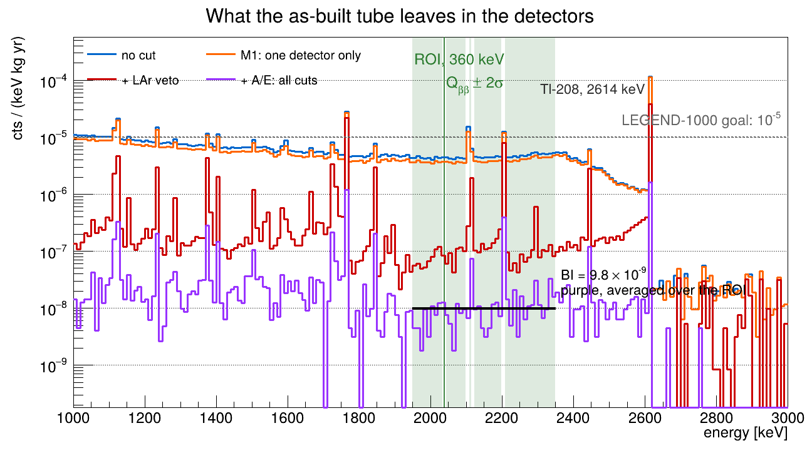
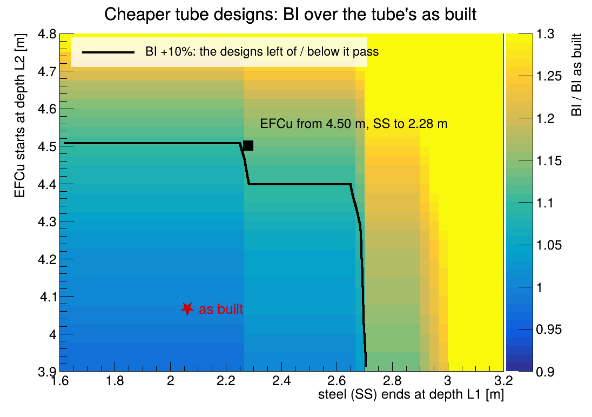

# LEGEND-1000 re-entrance tube

The re-entrance tube (RT) holds the underground argon (UGLAr) and the detector array. It is a 6 m × 2 m cylinder of
steel (SS) at the top, oxygen-free high-conductivity (OFHC) copper (Cu) in the middle and electroformed copper (EFCu),
3-7 × less radioactive than the Cu, around the detectors.

**The question:** how much of the expensive EFCu can be cut, and how much cheap SS added, without changing the
tube's background index (BI)? "Without changing" means within 10%.

**The answer** (depths below the tube's top; as built the SS ends at 2.06 m and the EFCu starts at 4.07 m):

|                                                                 | SS : Cu : EFCu     | BI after all cuts [counts/(keV·kg·yr)]       |
| --------------------------------------------------------------- | ------------------ | -------------------------------------------- |
| as built                                                        | 619 : 672 : 175 kg | 0.94 ± 0.09 × 10⁻⁸ (before cuts 4.29 × 10⁻⁶) |
| EFCu from 4.40 m (0.33 m shorter), SS to 2.69 m (0.63 m longer) | 809 : 489 : 146 kg | +8%: within 10%                              |

[Getting started](#getting-started) · [how radioactive is EFCu?](#how-radioactive-is-efcu) · [Method](#method) ·
[Results](#results) · [Future work](#future-work)

## Getting started

Getting to the first simulation took most of the work. The LEGEND-1000 geometry is generated with the collaboration's
`legend-pygeom-l1000` package, written out as GDML, and read by remage, the collaboration's Geant4 application, which
registers the 336 germanium detectors from a map stored in the GDML file itself. The software was first built from
source for this work: Geant4, BxDecay0 and remage, on both Apple Silicon and Linux, through a chain in which each stage
tests itself before passing on ([ElmikawyStack2026](https://github.com/h0t5tuff/Physics-Simulation-Stack)); on Apple
Silicon, remage 0.26 also needed its library paths patched by hand. Over the course of this work the remage setup grew
from separate tutorial examples into the single simulation used here, `sim/run.mac`, on remage's 1.1.0 release: pixi
on the Mac, the collaboration's container on NERSC.

The first geometry tried was a modified file, `KSendcap_l1kGeometry.gdml` (KS). Against the unmodified geometry, its
tube's radius and its position along the axis were both shifted by 68 mm, with its length unchanged, and its endcap
was 1 mm wider than the barrel where the two meet, so the tube check of §1 failed. Everything here uses the unmodified
geometry ([ElmikawyRTsim2026](https://github.com/h0t5tuff/LEGEND1000-Simulation)).

Three words, used throughout:

- **decay:** one simulated nuclear decay of Tl-208 or Bi-214 in the tube's wall (a whole chain, for the holders);
- **hit:** the energy one decay leaves in one detector; `sim/hit.py` makes them from the simulation's steps, and one
  decay can leave hits in several detectors;
- **count:** a decay whose energy in a detector lands in the ROI (the 100 keV window around `Qββ`, §4), after the
  cuts in force. The simulation gives *simulated counts*; each stands for w real decays a year, and Σw is the
  *counts a year* (§4).

## how radioactive is EFCu?

What EFCu's own radioactivity looks like in the detectors. The 1008 EFCu detector holders
(`hpge_string_support_weldment_copper`, 1.92 kg in all), clamping each detector's PEN plate to the support rods, decay with
EFCu's Th-232 and U-238 chains: 370 k and 190 k chains, the ratio of EFCu's activities (0.37 : 0.19 µBq/kg), so the
two spectra add as counted. Two lines threaten `Qββ` = 2039 keV, the energy of neutrinoless double-beta decay
(0νββ): **Tl-208 at 2614 keV** and **Bi-214 at 2448 keV**, whose gammas can leave that much in a detector.


The energy each of the 336 detectors gets, without the detector response (§3), summed over 10 µs: 434 263 such
hits from the Th-232 chains, 176 339 from the U-238. `sim/holders.mac` writes every germanium step (`stp/germanium`: `evtid`, `det_uid`, `edep_in_keV`,
`time_in_ns`, ...) and one row per chain (`stp/vtx`) to `output/holders_th232.root` and `holders_u238.root`;
`ana/holders.C` draws them.

```bash
~/venvs/v/bin/python geom/l1000geom/l1000-autopeel.py --holders output/holders_geometry.png
remage -q --ignore-warnings -t 8 -w -o output/holders_th232.root -s GDML=geom/l1000geom/l1000.gdml -s Z=90 -s A=232 -s NEV=370000 -s SEED=21 -- sim/holders.mac
remage -q --ignore-warnings -t 8 -w -o output/holders_u238.root -s GDML=geom/l1000geom/l1000.gdml -s Z=92 -s A=238 -s NEV=190000 -s SEED=22 -- sim/holders.mac
root -l -b -q ana/holders.C
```

## Method

Five steps. From the NERSC decays already in `output/output_lh5`, the commands of §3 and §4 redo the response and
the analysis, §5 included (it runs inside `ana/background.C`).

### 1. The geometry

`geom/l1000geom/l1000.gdml` (legend-pygeom-l1000 0.6.0), the full LEGEND-1000 geometry. The tube is 6.246 m tall and
0.999 m in radius; the 336 detectors sit 4.8-5.9 m below its top, inside the EFCu section.

Two checks run before any physics ([ElmikawyRTsim2026](https://github.com/h0t5tuff/LEGEND1000-Simulation)). The first
builds the geometry and scans it for overlapping volumes: none (83 s). The second, at the start of
`ana/background.C`, reads the tube from the GDML, with the densities and the germanium mass, and checks it: a clean
outline, the bottom head and the Cu and SS layers flush with the barrel. It also profiles the wall: 1.5 mm of EFCu
through the endcap and lower wall, thickening to 3 mm over the last 2 cm below the Cu seam, and 6 mm through the Cu
and SS.

Every later step reads the tube from this one file (the analysis, the pictures, the app), so no calculation uses a
radius or seam typed into a script, apart from the lid's position, which `sim/run.mac` leaves out of the sampling.
Wall volumes are computed by integrating the GDML outlines; an independent integration, by sampling points in the
solids, agrees to 0.1%. A new design is a new GDML file; apart from that lid position, nothing downstream needs
editing.


The tube's outline as `ana/background.C` reads it: its three sections, the decay sources, and the two seams a design
moves (z = 920 and 2925 mm in the GDML).


The underground argon around the detectors (18.83 m³, 26.17 t) is the veto, its light read by 12096 fibres and 252
silicon photomultipliers (SiPMs).


Each detector is an inverted-coaxial point-contact (ICPC) germanium detector, 90.0 mm tall and 88.8 mm across, its
borehole 53 mm deep from the top: 3.046 kg, 1023.4 kg in all. `geom/l1000geom/l1000-autopeel.py` draws each part
alone, offscreen, and prints its numbers:

```bash
remage --ignore-warnings -s GDML=geom/l1000geom/l1000.gdml -s SKIP=false -s NPOINTS=1000 -- geom/l1000geom/check.mac 2>&1 | grep "Overlap is detected"
~/venvs/v/bin/python geom/l1000geom/l1000-autopeel.py --tube output/tube_geometry.png
~/venvs/v/bin/python geom/l1000geom/l1000-autopeel.py --uglar output/uglar_geometry.png
~/venvs/v/bin/python geom/l1000geom/l1000-autopeel.py --hpge output/hpge_geometry.png
```

### 2. Simulation

With `sim/run.mac` (remage), one nuclide decays uniformly through one section of the tube wall: **Tl-208** (²³²Th
chain) or **Bi-214** (²³⁸U chain), the only chain members whose gammas reach `Qββ`. It records the energy each decay
leaves in each detector and in the UGLAr. Its `-s` aliases: `GDML`; `Z` `A` (Tl-208: 81 208, Bi-214: 83 214); `NEV`;
`SEED`, which starts remage's random numbers (the same seed repeats the same decays, so every run has its own) and
names the run's file; `VOLS`, a regex over the source volumes `reentrance_tube_copper` (EFCu),
`reentrance_tube_layer_copper_ofhc` (Cu) or `reentrance_tube_layer_steel_316L` (SS). Each run is 10 M decays of one
nuclide in one section, a 32-thread NERSC task of 16-75 min, and writes
`output/output_lh5/<nuclide>_<SEED>.lh5`: `stp/` (the steps in the germanium detectors and in
`liquid_argon_underground`), `vtx` (one row per decay, with its position), `detector_origins`,
`number_of_simulated_events`. They are kept: every rerun starts here. The tube has no lid: `sim/run.mac` leaves the
EFCu's top closure out of the sampling, and the first six EFCu runs, made before that, had its decays removed from
their files afterwards (7.6 M of each 10 M kept).

The sections are simulated separately because their decays reach the detectors at very different rates, so each gets
the decays it needs (a run over the whole tube would put nearly 9 in 10 of its decays in the Cu and SS, which the detectors
barely see); §5 combines them into any design:

| section | runs | decays (Tl-208 / Bi-214) | real years they stand for | why that many                                                                                           |
| ------- | ---- | ------------------------ | ------------------------- | ------------------------------------------------------------------------------------------------------- |
| EFCu    | 25   | 122 M / 112 M            | 166 000 / 107 000         | next to the array, they give 122 of the BI's 128 counts after all cuts: the BI's ±9%                    |
| Cu      | 366  | 460 M / 3.2 G            | 55 000 / 116 000          | they decide how far the SS can come down (§5): one count, turned into SS, adds 12% of the BI            |
| SS      | 36   | 50 M / 310 M             | 7 / 6                     | 2.7-4.8 m above the array: none of their decays puts a count in the ROI (§4), at any cut level          |
| total   | 427  | 4.3 × 10⁹                |                           | 76 GB                                                                                                   |

"Real years": how long the section, as built, takes to make that many decays (its activity × mass, §4). In the Cu and
SS, Bi-214 needs ~7 × the decays of Tl-208: the SS holds ~7 × more Bi-214 than Tl-208 (2500 vs 360 µBq/kg), and a
count turned into SS (§5) must weigh the same in both chains. On NERSC's Perlmutter the runs took 142 task-hours, 20
node-hours of the m2676 allocation (16 min for a typical Cu run, about an hour for an EFCu run); back to back on an
M1 Pro MacBook (8 threads: 22.5 min for a Cu run, 2.9 h for an EFCu run) ~220 hours, about 9 days. Another 55 node-hours went into runs that turned out not to change
the answer, and were deleted.

**How many decays each section needs.** Measured, not guessed, per nuclide and section:

1. **The count rate per decay**, p = simulated counts after all cuts ÷ simulated decays. It is set by the geometry and
   the cuts, not by how many decays are run, so one or two runs measure it.
2. **The counts needed.** A nuclide-section that makes a share f of the BI, with n simulated counts, adds f²/n to the
   BI's relative uncertainty, squared: (BI uncertainty)² = Σ f²/n. For ±10%, the size of the 10% line: Σ f²/n ≤ 0.01.
3. **The decays needed** = counts needed ÷ p.

From the first 408 runs, in the 100 keV ROI, with the A/E cut then at −1.06 (§4's table has today's numbers):

| nuclide | section | share f of the BI | p = counts ÷ decays          | counts needed for ±10% | decays needed | decays then  |
| ------- | ------- | ----------------- | ---------------------------- | ---------------------- | ------------- | ------------ |
| Tl-208  | EFCu    | 58%               | 15 ÷ 22.6 M = 6.6 × 10⁻⁷     | ~80                    | ~120 M        | 22.6 M       |
| Bi-214  | EFCu    | 33%               | 6 ÷ 22.6 M = 2.7 × 10⁻⁷      | ~28                    | ~105 M        | 22.6 M       |
| Tl-208  | Cu      | 6.5%              | 3 ÷ 460 M = 6.5 × 10⁻⁹       | 3: enough              | 460 M         | 460 M        |
| Bi-214  | Cu      | 2%                | 2 ÷ 3.2 G = 6.3 × 10⁻¹⁰      | 2: enough              | 3.2 G         | 3.2 G        |
| both    | SS      | 0%                | 0 ÷ 360 M                    | none                   | —             | 50 M / 310 M |

Then: 0.58²/15 + 0.33²/6 + 0.065²/3 + 0.02²/2 = 0.043, ±21%. With ~80 and ~28 EFCu counts it is 0.0098, ±10%: the
EFCu needs ~5 × its decays, the Cu and SS none. The 19 EFCu runs this asked for, 10 M decays each without the lid
(10 Tl-208, 9 Bi-214, 2.7 node-hours), brought the EFCu to 122 counts after all cuts (77 Tl-208, 45 Bi-214, with the
production's A/E cut, §4) and the BI to ±9%.

A design adds one need. A count moved into a new material takes that material's weight, so the decays of the section
it comes from set how big a step one count is. For the SS limit that is the Cu: one Cu count turned into SS adds 12%
of the BI. Bringing that to ~3% would take ~4 × the Cu decays (~1.8 G Tl-208 and ~13 G Bi-214, ~40 node-hours): not
worth it, so the SS limit stays set by a single count.

To rerun them (`<SEEDS>`: EFCu 7001-7013 / 8001-8012, Cu 5001-5046 / 6001-6320, SS 3001-3005 / 4001-4031 for
Tl-208 / Bi-214; `<NUCLIDE>` `<Z>` `<A>`: `tl208 81 208` or `bi214 83 214`; `<VOLS>` the section's volume):

```bash
ssh nersc 'mkdir -p $SCRATCH/LEGEND1000-Simulation/sim $SCRATCH/LEGEND1000-Simulation/geom/l1000geom $SCRATCH/LEGEND1000-Simulation/output/output_lh5'
rsync -a geom/l1000geom/l1000.gdml nersc:'$SCRATCH/LEGEND1000-Simulation/geom/l1000geom/'
rsync -a sim/run.mac nersc:'$SCRATCH/LEGEND1000-Simulation/sim/'
ssh nersc 'shifterimg pull docker:legendexp/remage:v1.1.0'
ssh nersc 'cd $SCRATCH/LEGEND1000-Simulation && sbatch --account=m2676 --qos=shared --constraint=cpu --cpus-per-task=32 --time=01:30:00 --output=output/%x_%a.log --image=docker:legendexp/remage:v1.1.0 --array=<SEEDS> --job-name=rt --wrap "shifter --module=none remage -q --ignore-warnings -t 32 -w -m -s GDML=geom/l1000geom/l1000.gdml -s NEV=10000000 -s SEED=\$SLURM_ARRAY_TASK_ID -o output/output_lh5/<NUCLIDE>_\$SLURM_ARRAY_TASK_ID.lh5 -s Z=<Z> -s A=<A> -s VOLS=<VOLS> -- sim/run.mac"'
rsync -a --include='*_[0-9][0-9][0-9][0-9].lh5' --exclude='*' nersc:'$SCRATCH/LEGEND1000-Simulation/output/output_lh5/' output/output_lh5/
ssh nersc 'rm -r $SCRATCH/LEGEND1000-Simulation'
```

### 3. Detector response

`sim/hit.py` (reboost 1.4) turns each run's steps into what the detectors measure: in the germanium, the energy
through the dead layer, the resolution and the A/E classifier; in the UGLAr, the photoelectrons (PE) the SiPMs see.
Its inputs: the response parameters of [legend1000-metadata](https://github.com/legend-exp/legend1000-metadata)
(`~/Documents/legend-exp/legend1000-metadata`, `simprod/config`, experiment `l1000dsg01`: the settings of
LEGEND-1000's simulation production, which [legend-simflow](https://github.com/legend-exp/legend-simflow) runs), the UGLAr optical map v0.4.0 and the drift-time maps
of `V00000A` (3500 V, ⟨100⟩ and ⟨110⟩ axes), applied with [reboost](https://reboost.readthedocs.io). Every detector is
the dummy `V99999Z`, with the drift times of `V00000A` (the same geometry): a stand-in, since real detectors would each
bring their own dead layer, resolution and A/E.

|            | value                                                                                 | from                                                         |
| ---------- | ------------------------------------------------------------------------------------- | ------------------------------------------------------------ |
| dead layer | full-charge-collection depth (FCCD) 0.7 mm, outer half fully dead, linear in between  | `V99999Z`; `tier/hit` `dead_layer_fraction` 0.5              |
| resolution | FWHM = √(0.5 + 0.001·E) keV: 1.59 keV at `Qββ`                                        | `pars/geds/eresmod`                                          |
| A/E        | A: max of one template current pulse per step, at its drift time; σ_A/E = 0.01        | `pars/geds/currmod`, `aoeresmod`; `output/dtmap_V00000A.lh5` |
| PE         | LAr scintillation × the summed optical map; σ 0.3 PE, 16 ns merging, ≤ 100 PE per hit | `/all` of the optical map; `tier/opt`                        |

- **A/E** is the amplitude of the current pulse over the energy. A gamma that scatters several times in the crystal
  spreads its charge out in time, giving a broad, low pulse: A/E << 1. 0νββ puts its energy (two electrons) in one
  spot: A/E ≈ 1. The drift-time maps give how long each step's charge takes to reach the contact, which shapes the
  pulse; one template pulse is used, not a pulse-shape library.
- **Optical map** (Moritz Neuberger's, on NERSC): for every 5 mm cell of the UGLAr, the probability that a
  scintillation photon made there reaches a SiPM; its `/all` group sums every SiPM, as the LAr veto does (the
  production's second condition, 4 SiPMs with light, and random coincidences are left out). This v0.4.0 map stops
  68 mm short of this UGLAr's outer wall (the argon there takes the light at the map's edge), and argon above
  z = 1.375 m gives no light, so until the 0.6.0 map
  arrives the BI is a 0.9-2.8 × 10⁻⁸ range (2.8 × 10⁻⁸ with the LAr veto read off the map alone, no light from the
  argon beyond its edge).

`sim/hit.py` writes `output/output_root/<nuclide>_<SEED>_hit.root` (~7 s a file, 20-40 s for an EFCu run; ~50 GB in all; only `ana/background.C` reads
them): TTrees `geds` (`evtid`, `det`, `edep`, `energy` [keV], `aoe_class`), `lar` (`evtid`, `edep`, `pe`, `pe_map`),
`vtx` (`evtid`, `xloc`, `yloc`, `zloc` [m]). Options: `--optmap`, `--dtmap`, `--metadata`, `--gdml`, `--outdir`
(defaults: the two maps fetched below, the metadata above, §1's GDML, `output/output_root`); `--seed` (default 1; not remage's `SEED`: with each
file's name it seeds the smearing, photons and photoelectrons, so a file always gives the same hits); `--force`
(rebuilds a hit file that is newer than its inputs, otherwise kept). A new optical map needs only `--optmap` and §4
again, no new simulation. The two maps, then the response:

```bash
rsync -a --partial nersc:/global/cfs/cdirs/m2676/users/neuberger/L1000_optical_muon_sims/omaps/v0.4.0/ular/merged/merged_optmap_20260225_063750.lh5 output/
rsync -a nersc:/global/cfs/cdirs/m2676/users/neuberger/L1000_optical_muon_sims/hpge_related/dtmaps/gen/V00000A.lh5 output/dtmap_V00000A.lh5
~/venvs/v/bin/python sim/hit.py output/output_lh5/*.lh5
```

### 4. Cuts and BI

`ana/background.C` is the analysis and its figures. Its arguments, both optional: the hit files, as `pattern=nuclide`
pairs (wildcards merge files; default: the Tl-208 and Bi-214 sets in `output/output_root`), and the GDML (default
`geom/l1000geom/l1000.gdml`). The cuts, activities and the 10% line are in `cfg` (`m1_keV`, `lar_pe`, `psd_low`,
`chain`, `simTol`).

**Cuts**, in LEGEND's order: **M1** (exactly one detector above 25 keV) and the **LAr veto** (rejects ≥ 4 PE), both
from legend1000-metadata's `tier/evt`; then **A/E** > −1.5, single-site-like: the production's cut, one value for
all detectors. In data LEGEND places it to keep 90% of the Tl-208 double-escape peak (DEP, 1592.5 keV, single-site).
Here −1.5 keeps 87 ± 3% of the simulation's 2992 DEP counts after M1 (net of the continuum), and 90% would take −6.6:
this one-template A/E leaves the DEP's A/E with a long flat tail, and at −6.6 the other peaks pass 3 × what HADES
measures. So the production's cut is kept. What it keeps of each Tl-208 peak and of the ROI, next to `V00000A`'s
measurement at HADES (the underground lab where LEGEND characterises its detectors):

| kept by A/E        | DEP 1592.5 keV | SEP 2103.5 keV (single escape) | FEP 2614.5 keV (full energy) | ROI  |
| ------------------ | -------------- | ------------------------------ | ---------------------------- | ---- |
| this simulation    | 0.87           | 0.03                           | 0.05                         | 0.29 |
| `V00000A` at HADES | 0.90           | 0.04                           | 0.06                         | 0.27 |

**BI** is counts in the **ROI**, one window around `Qββ`: `Qββ` ± 50 keV (1989-2089 keV, **100 keV**), stopping
short of Tl-208's single-escape peak at 2103.5 keV, as Ralph Massarczyk's tube study does (13 Oct 2026, ± 55 keV);
per keV, per kg of germanium (1023.4 kg), per year: counts/(keV·kg·yr). The LEGEND-1000 goal is 1 count a year in
10³ kg and 10² keV, 10⁻⁵ counts/(keV·kg·yr). A signal would sit in `Qββ` ± 2σ (2037.6-2040.4 keV, ~95% of a 0νββ peak at this
resolution): the background expected there is the BI × 2.7 keV × the exposure.

**From decays to counts.** Each simulated decay stands for w real decays a year, its weight:

- w = real decays / simulated decays = mass (kg) × activity (µBq/kg) × 0.36 (Tl-208) or 1 (Bi-214) × 1 yr /
  simulated decays, knowing Bq = decays/s (Tl-208 is 35.94% of the ²³²Th chain,
  [Nuclear Data Sheets](https://doi.org/10.1016/j.nds.2007.07.001); Bi-214 all of the ²³⁸U chain);
- Σw over the simulated decays that land in the ROI = the counts a year;
- BI = counts a year / (1023.4 kg × 100 keV).

Bulk activities only, chains in equilibrium; the mass of each section is the GDML's. The activities (`cfg::chain`)
are from Ralph Massarczyk's MaterialMix talk (23 Jun 2026):

| µBq/kg | ²³²Th chain | ²³⁸U chain | source quoted there                                           |
| ------ | ----------- | ---------- | ------------------------------------------------------------- |
| SS     | 1000        | 2500       | Bernhard                                                      |
| Cu     | 1.1         | 1.3        | [MAJORANA assay](https://doi.org/10.1103/PhysRevC.110.055804) |
| EFCu   | 0.37        | 0.19       | M. Green                                                      |

The tube as built, from mass to BI (each section sampled at its own density, §2; decays counted where they happened,
so ~1 M of the EFCu runs' decays, just above the Cu seam, count as Cu):

| chain  | section | mass     | real decays a year | simulated decays | w           | simulated counts: no cut / M1 / + LAr / + A/E | counts a year, all cuts | BI, all cuts       |
| ------ | ------- | -------- | ------------------ | ---------------- | ----------- | --------------------------------------------- | ----------------------- | ------------------ |
| Tl-208 | EFCu    | 174.6 kg | 733                | 122 M            | 6.0 × 10⁻⁶  | 63755 / 52911 / 437 / 77                      | 4.6 × 10⁻⁴              | 4.52 ± 0.52 × 10⁻⁹ |
| Tl-208 | Cu      | 671.7 kg | 8 380              | 461 M            | 1.8 × 10⁻⁵  | 551 / 497 / 34 / 3                            | 0.5 × 10⁻⁴              | 0.53 ± 0.31 × 10⁻⁹ |
| Tl-208 | SS      | 619.4 kg | 7.0 × 10⁶          | 50.0 M           | 0.14        | 0 / 0 / 0 / 0                                 | 0                       | 0                  |
| Bi-214 | EFCu    | 174.6 kg | 1 047              | 112 M            | 9.4 × 10⁻⁶  | 4720 / 4383 / 588 / 45                        | 4.2 × 10⁻⁴              | 4.11 ± 0.61 × 10⁻⁹ |
| Bi-214 | Cu      | 671.7 kg | 27 560             | 3.20 G           | 8.6 × 10⁻⁶  | 170 / 160 / 42 / 3                            | 0.3 × 10⁻⁴              | 0.25 ± 0.15 × 10⁻⁹ |
| Bi-214 | SS      | 619.4 kg | 4.9 × 10⁷          | 310 M            | 0.16        | 0 / 0 / 0 / 0                                 | 0                       | 0                  |
| all    |         |          |                    | 4.26 G           |             | 128 after all cuts                            | 9.6 × 10⁻⁴              | 9.4 ± 0.9 × 10⁻⁹   |

```bash
root -l -b -q ana/background.C
```

### 5. Finding the best design: reweighting

A design moves the two seams: the SS ends at depth L1 (2.06 m as built) and the EFCu starts at depth L2 (4.07 m),
with Cu between. The wall keeps its shape and thickness as built; only the material of each part changes (EFCu turned
into Cu at 4.07-4.40 m is the EFCu's 1.5 mm wall, made of Cu). `ana/background.C` scans them: for every L2, L1 goes
down 1 cm at a time while the BI stays within 10% of the as-built's. The answer is the least EFCu, then, for it, the
most SS.

**Reweighting, not resimulating.** What a decay does in the detectors depends on where it happens, and very little on
what the wall there is made of: SS and Cu stop gammas about equally (8.0 vs 9.0 g/cm³). So each simulated decay can
stand for any material a design puts at its depth; only its w changes (§4): that material's real decays a year per m³
(density × activity) over the simulated decays per m³ of the run the decay came from. A design's counts a year are
Σw with the new weights, so any L1 and L2 can be tried without a new simulation. The decays at a depth come from the section
built there (SS runs 0-2.06 m, Cu runs 2.06-4.07 m, EFCu runs 4.07-6.25 m), so the two savings reweight different
runs:

| design change                     | decays reweighted                                  | w × (Tl-208 / Bi-214)      | simulated counts there           |
| --------------------------------- | -------------------------------------------------- | -------------------------- | -------------------------------- |
| EFCu starts lower (L2 deeper)     | the EFCu runs', from 4.07 m to L2: EFCu becomes Cu | 3.0 / 6.8                  | thousands: the change is precise |
| SS comes further down (L1 deeper) | the Cu runs', from 2.06 m to L1: Cu becomes SS     | 810 / 1700                 | a handful: each one matters      |

**Why the Cu runs decide the SS.** The SS added in a design would sit where the Cu is now, 2-3 m above the array,
and only the Cu runs have decays there. Those decays rarely reach the detectors: there, one in ~5 × 10⁷ Tl-208
decays gives an ROI count after M1, and none of 1.7 × 10⁹ Bi-214 decays does (the table below). Turned into SS, each
such count weighs ~1000 times more: one adds 12% of the BI, more than the 10% line. So the SS can come down to just
above the first such count, at 2.70 m: the step in the design map.

**Cut survival.** Too few counts survive all cuts away from the detectors to measure the change on them, so it is
measured on the ROI counts that pass M1, 100-700 times more, times the **cut survival**: the fraction of them that
also pass the LAr veto and A/E. It is taken where the change is, from the simulated ROI counts per 0.62 m slab below
the tube's top (the table):

- near the detectors (below 4.37 m), per chain: 1.4 × 10⁻³ (Tl-208), 1.0 × 10⁻² (Bi-214);
- higher up, both chains together: 10 of 1258 = 8.0 × 10⁻³. Tl-208's counts survive ~4 × more often there, partly
  because the optical map gives no light above z = 1.375 m.

| depth [m]                        | Tl-208 decays | ROI after M1 | after all cuts | Bi-214 decays | ROI after M1 | after all cuts |
| -------------------------------- | ------------- | ------------ | -------------- | ------------- | ------------ | -------------- |
| 0.00-1.87                        | 45.4 M        | 0            | 0              | 282 M         | 0            | 0              |
| 1.87-2.50                        | 105 M         | 0            | 0              | 729 M         | 0            | 0              |
| 2.50-3.12                        | 144 M         | 5            | 0              | 1.00 G        | 0            | 0              |
| 3.12-3.75                        | 144 M         | 97           | 0              | 1.00 G        | 29           | 2              |
| 3.75-4.37                        | 90.3 M        | 959          | 6              | 511 M         | 168          | 2              |
| 4.37-5.00                        | 36.7 M        | 11645        | 16             | 33.8 M        | 958          | 7              |
| 5.00-5.62                        | 36.7 M        | 26443        | 37             | 33.7 M        | 2217         | 23             |
| 5.62-6.25, nearest the detectors | 29.9 M        | 14259        | 21             | 27.5 M        | 1171         | 14             |

## Results

**The BI as built** through the cuts, in counts/(keV·kg·yr) (the LEGEND-1000 goal is 10⁻⁵; per chain and section in
§4's table):

| no cut      | M1                          | M1 + LAr                                     | all cuts (M1 + LAr + A/E)                           |
| ----------- | --------------------------- | -------------------------------------------- | --------------------------------------------------- |
| 4.29 × 10⁻⁶ | 3.61 × 10⁻⁶: M1 removes 16% | 0.89 ± 0.03 × 10⁻⁷: the LAr veto removes 98% | **0.94 ± 0.09 × 10⁻⁸**: A/E removes 89% of the rest |



The tube's spectrum as built, through each cut: the ROI shaded green with `Qββ` as a line, the BI after all cuts as
the black line across it, the 10⁻⁵ goal dashed.

**The designs**: for each depth L2 where the EFCu starts, the deepest L1 where the SS can end:

| EFCu from (L2)    | EFCu       | SS to (L1) | SS : Cu : EFCu         | BI change                      |
| ----------------- | ---------- | ---------- | ---------------------- | ------------------------------ |
| 4.07 m, as built  | 175 kg     | 2.69 m     | 809 : 460 : 175 kg     | +0%                            |
| 4.20 m            | 163 kg     | 2.69 m     | 809 : 472 : 163 kg     | +2%                            |
| 4.30 m            | 154 kg     | 2.69 m     | 809 : 480 : 154 kg     | +4%                            |
| **4.40 m**        | **146 kg** | **2.69 m** | **809 : 489 : 146 kg** | **+8%**                        |
| 4.50 m and deeper | ≤ 137 kg   | none       |                        | more than 10% at any SS length |

- **EFCu** can start 0.33 m lower, at 4.40 m: 146 kg instead of 175 (−17%). Deeper, the Cu that would replace it
  sits next to the detectors at 3-7 × EFCu's activity, and the BI rises more than 10% whatever the SS.
- **SS** can come down to 2.69 m: 809 kg instead of 619 (+190 kg), whatever the EFCu, just above the first Cu count
  that, turned into SS, would add 12% at once.
- **The SS as built** never reaches the detectors: no ROI count at any cut level in its 360 M decays.



The designs near the tube as built, coloured by their BI over the as-built's: the designs left of and below the bold
+10% line keep the BI. The star is the tube as built, the square the answer. `/Applications/LEGEND.app`'s rt shows
the same scan (`output/designs.json`) on the GDML's tube in 3D: two sliders for L1 and L2 recolour the tube by its BI
and give the masses. To build and install it:

```bash
~/venvs/v/bin/python app/make_app.py
```

## Future work

**The Hall C geometry.** Matthew Busch's string and lock update (29 Sep 2026) proposes 12-detector strings, for
running beyond 1 t, at the same central depth in the UGLAr:

- **Array**: 42 strings × 8 detectors × 3 kg = 1008 kg becomes 48 × 12 × 3 kg = 1728 kg. Each string's germanium
  grows from 1.08 to 1.64 m and its fibres from 1.36 to 1.92 m, reaching 0.28 m higher and 0.28 m deeper.
- **Tube**: 0.2 m longer, the extra height in the Cu section, and a deeper bottom head (467 → 575 mm deep): more UGLAr.
- **Lab**: the cleanroom floor, cryostat and water tank drop 0.2 m; the lock pipe grows from 7.54 to 7.81 m. It
  still waits on the crane and cleanroom details.

He makes the change conditional on the background simulations, which is what this study can answer. The array
reaches 0.28 m higher, so the EFCu likely has to start higher too; the design scan says how much. It needs
the Hall C geometry from legend-pygeom-l1000 (`units: n: 12` in its `configs/string.yaml`, 48 strings, the longer
tube and head), then the same NERSC runs and analysis on it.
