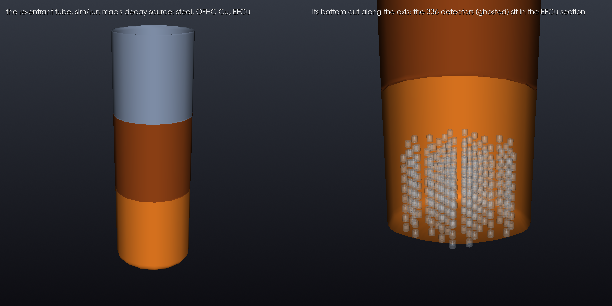
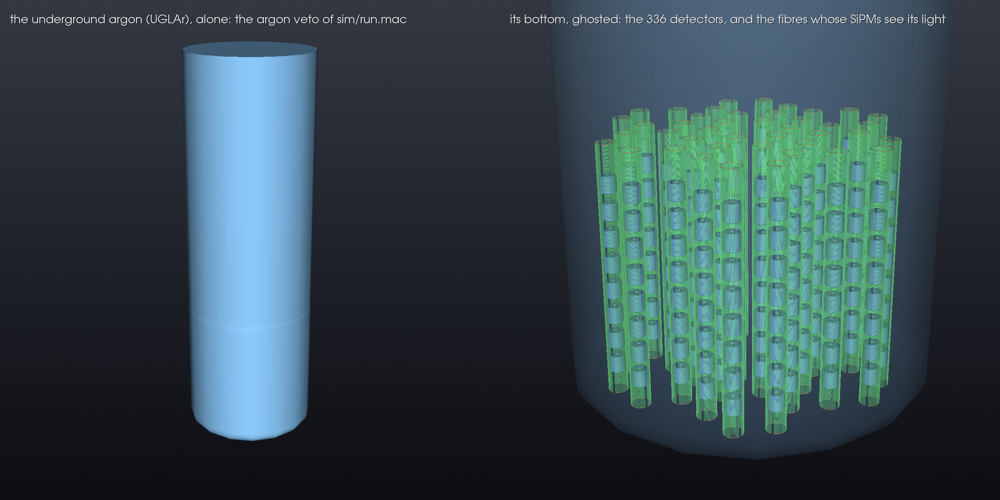
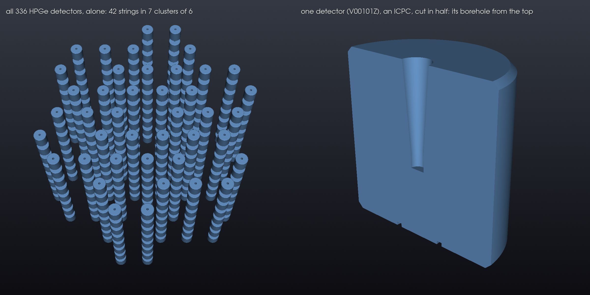
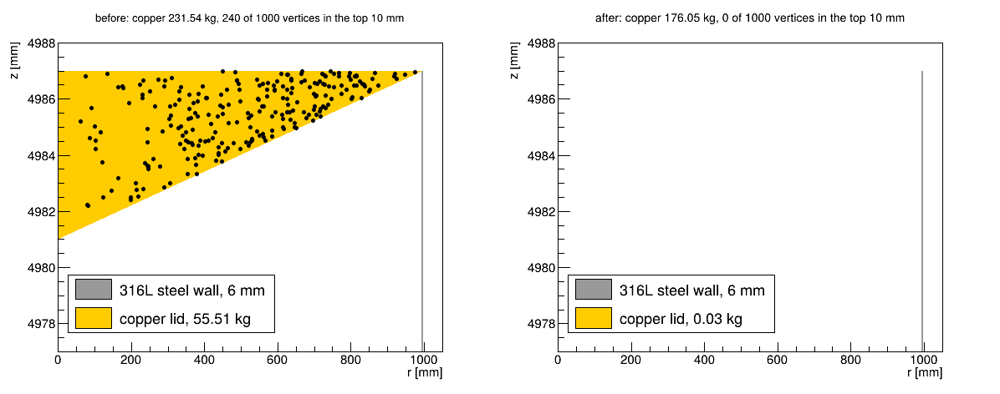
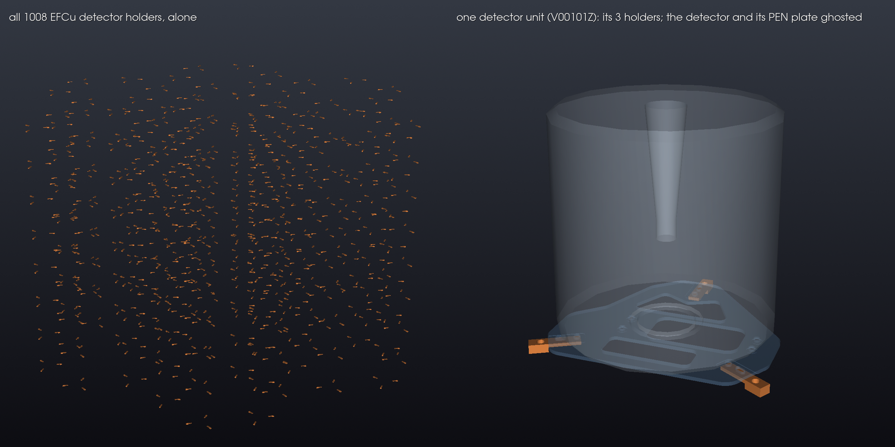
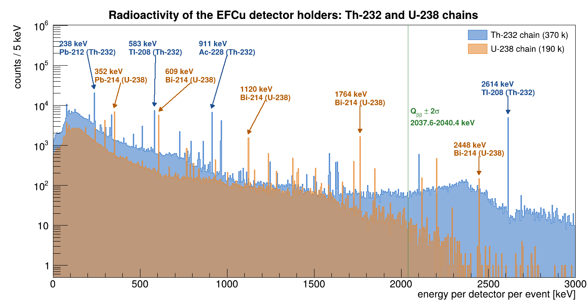
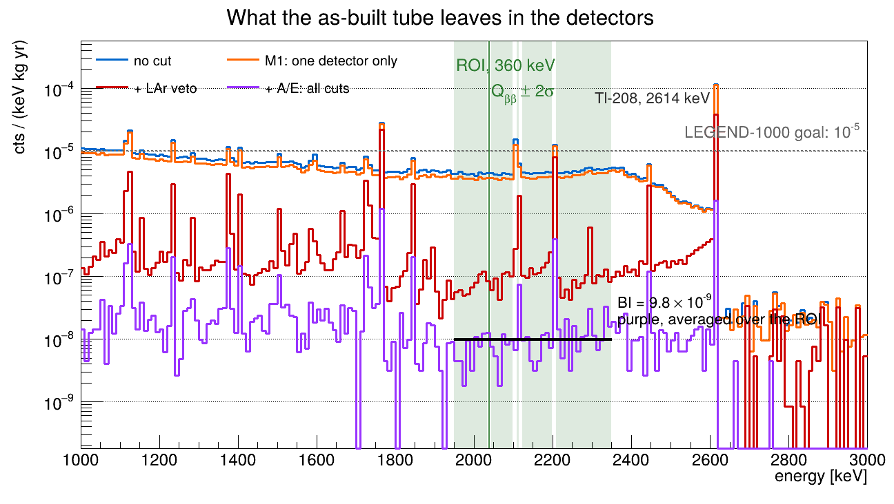
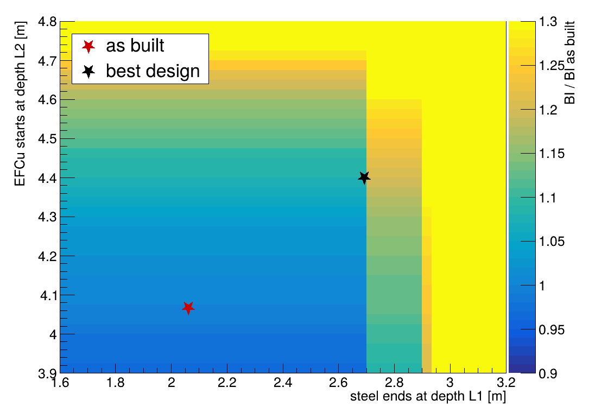

# LEGEND 1000 Background Index

How much electroformed copper does the LEGEND-1000 re-entrance tube need? A remage simulation of the tube, from its
geometry to a design.

Every claim has its source in place: a PDF (files named `….pdf` are in iCloud Drive, `0νββ/Papers` or
`0νββ/Presentations`; "p." is the PDF's page) or this repository's own output, with the command that makes it.

## The question

1. **The tube.** The re-entrance tube (RT) holds the underground argon (UGLAr) and the detector array
   (`LEGEND1000pCDR, LEGEND.pdf`, p. 8). It is a 6 m × 2 m cylinder: steel (SS) at the top, oxygen-free
   high-conductivity (OFHC) copper (Cu) in the middle, electroformed copper (EFCu) around the detectors
   (`ReentrantTubeFabrication, Lee.pdf`, p. 9).
2. **Why EFCu.** It is the least radioactive: 3-7 × below Cu, over 1000 × below SS (step 6).
3. **Why less of it.** It comes as sheets from the Sanford Underground Research Facility, and the raw materials'
   on-time delivery is among the tube's most critical activities (Lee, p. 5, 16).
4. **The risk.** Neutrinoless double-beta decay (0νββ) of ⁷⁶Ge would leave `Qββ` = 2039 keV in a detector (pCDR,
   p. 7). A gamma from a decay in the tube wall can leave the same energy: background.
5. **The measure.** The background index (BI): background counts per keV, per kg of germanium, per year, around
   `Qββ`. LEGEND-1000's goal is below 10⁻⁵ counts/(keV·kg·yr) (pCDR, p. 8): 1 count a year in 10³ kg and 10² keV.
6. **What was missing.** Ralph Massarczyk's tube study asked where EFCu is needed and how far from the array the SS
   must end. Its one simulation over the whole tube left 1 simulated count from the Cu and none from the SS after
   all cuts; it concluded that optimising "needs full remage simulations" (`ralph_GeneralCall_10_12_2026.pdf`,
   13 Oct 2026, p. 2, 16, 29).
7. **This study** simulates each section on its own, computes the BI as built, then the BI of every other design.

**The question:** how much of the EFCu can be cut, and how much SS added, without changing the tube's BI? "Without
changing" means within 10%, this study's line (step 6).

**The answer** (depths below the tube's top; as built the SS ends at 2.06 m and the EFCu starts at 4.07 m):

|                                                                 | SS : Cu : EFCu     | BI after all cuts [counts/(keV·kg·yr)]       |
| --------------------------------------------------------------- | ------------------ | -------------------------------------------- |
| as built                                                        | 619 : 672 : 175 kg | 0.94 ± 0.09 × 10⁻⁸ (before cuts 4.29 × 10⁻⁶) |
| EFCu from 4.40 m (0.33 m shorter), SS to 2.69 m (0.63 m longer) | 809 : 489 : 146 kg | +8%: within 10%                              |

Four words, used throughout:

- **decay:** one simulated nuclear decay in the tube wall;
- **hit:** the energy one decay leaves in one detector; a decay can leave hits in several;
- **ROI:** the window `Qββ` ± 50 keV (1989-2089 keV, **100 keV**) in which background is counted; it stops short of
  Tl-208's single-escape peak at 2103.5 keV;
- **count:** a decay whose hit lands in the ROI after the cuts (step 5). The simulation gives _simulated counts_;
  each stands for w real decays a year (step 6), and Σw is the _counts a year_.

## Setup

- **Geometry:** legend-pygeom-l1000 0.6.0.
- **Simulation:** remage 1.1.0 (`remage paper, LEGEND.pdf`): pixi on the Mac, the collaboration's container on NERSC.
- **Python:** `~/venvs/v` (Python 3.14: reboost 1.4.0, legend-pygeom-l1000 0.6.0, pylegendmeta, uproot, vtk).
- **Analysis:** ROOT 6.40.
- **Building from source** (Geant4, BxDecay0, remage):
  [Physics-Simulation-Stack](https://github.com/h0t5tuff/Physics-Simulation-Stack).

## Method

Seven steps, each needed by the next. Only the PNGs of `output/` are in git; the commands in each step remake the rest.

| step                 | the question it answers                    | code                                      | output                          |
| -------------------- | ------------------------------------------ | ----------------------------------------- | ------------------------------- |
| 1. Geometry          | what is the tube, exactly?                 | legend-pygeom-l1000, `geom/l1000geom/`    | `l1000.gdml`, `output/tube.txt` |
| 2. Decays            | which decays can reach `Qββ`?              | `sim/sim.mac`, `holders()` in `ana/ana.C` | `output/holders_spectrum.png`   |
| 3. Simulation        | what do they leave in the detectors?       | `sim/sim.mac` on NERSC                    | `output/output_lh5` (76 GB)     |
| 4. Detector response | what would be measured?                    | `sim/hit.py`                              | `output/output_root` (~50 GB)   |
| 5. Cuts              | which hits could pass for 0νββ?            | `ana/ana.C`                               |                                 |
| 6. BI as built       | what is the tube's BI, and how well known? | `ana/ana.C`                               | `output/slide_spectrum.png`     |
| 7. Designs           | which other designs keep it?               | `ana/ana.C`                               | `output/slide_designs.png`      |

### 1. Geometry

Every number here is read from `geom/l1000geom/l1000.gdml`, the full LEGEND-1000 geometry that legend-pygeom-l1000
writes:

- **Tube:** 6.246 m tall, 0.999 m in radius, its top at z = 4987 mm.
- **Seams,** the two a design moves: z = 920 mm (EFCu to Cu, 4.07 m deep) and z = 2925 mm (Cu to SS, 2.06 m deep).
- **Wall:** 1.5 mm of EFCu through the endcap and lower wall, thickening to 3 mm over the last 2 cm below the Cu
  seam; 6 mm through the Cu and SS, which are layers placed inside the EFCu tube volume.
- **Detectors:** 336 inverted-coaxial point-contact (ICPC) germanium detectors, 4.8-5.9 m below the top, inside the
  EFCu section. Each is 90.0 mm tall, 88.8 mm across, with a 53 mm borehole: 3.046 kg, 1023.4 kg in all.
- **Veto:** the UGLAr around the detectors (18.83 m³, 26.17 tonnes), its light read by 12096 fibres and 252 silicon
  photomultipliers (SiPMs).

Two checks, before any physics:

1. `check.mac` builds the geometry in remage and scans it for overlapping volumes, at 1000 surface points per
   volume: none is detected (the command below prints nothing; 96 s).
2. `l1000-autopeel.py --table` checks that the bottom head and the Cu and SS layers are flush with the barrel, then
   writes `output/tube.txt`: the seams, the densities, the germanium mass and the wall's cross-section every 0.5 mm.

Every later step reads the tube from `output/tube.txt`, so a new design is just a new GDML file. `l1000-autopeel.py`
also draws each part alone, offscreen, and prints its numbers.







```bash
export LEGEND1000_METADATA=~/Documents/legend-exp/legend1000-metadata
~/venvs/v/bin/legend-pygeom-l1000 -v geom/l1000geom/l1000.gdml
remage --ignore-warnings -s GDML=geom/l1000geom/l1000.gdml -s SKIP=false -s NPOINTS=1000 -- geom/l1000geom/check.mac 2>&1 | grep "Overlap is detected"
~/venvs/v/bin/python geom/l1000geom/l1000-autopeel.py --table output/tube.txt
~/venvs/v/bin/python geom/l1000geom/l1000-autopeel.py --tube output/tube_geometry.png
~/venvs/v/bin/python geom/l1000geom/l1000-autopeel.py --uglar output/uglar_geometry.png
~/venvs/v/bin/python geom/l1000geom/l1000-autopeel.py --hpge output/hpge_geometry.png
```

**The lid**, the one part of the GDML left out:

1. In legend-pygeom-l1000 0.6.0 the argon closes 6 mm below the tube's top on the axis but at the top at the wall,
   leaving a 55.51 kg EFCu cone over the tube's top (z = 4981-4987 mm): the lid, an artifact.
2. So `sim/sim.mac` keeps decays out of it, by position.
3. [legend-exp/legend-pygeom-l1000#142](https://github.com/legend-exp/legend-pygeom-l1000/pull/142) fixes it: the
   argon closes 1 µm below the top, leaving ~0.03 kg (EFCu 231.54 → 176.05 kg).
4. `geom/RTlidfix/` is the evidence (requested by Luigi Pertoldi): `before/` and `after/` hold the GDML at the PR's
   base and head, `confine.mac` samples 1000 remage vertices uniformly in `reentrance_tube_copper`, and `pr142.C`
   plots the tube's top from both. 240 of 1000 vertices fall in the lid before, none after.



```bash
cd geom/RTlidfix
remage -q -g before/l1000.gdml -o before/vtx.root -w confine.mac
remage -q -g after/l1000.gdml -o after/vtx.root -w confine.mac
root -l -b -q pr142.C
```

### 2. Decays

The wall's radioactivity is the ²³²Th and ²³⁸U decay chains in its metal. Which of their decays can reach `Qββ`?
To see, whole chains are decayed in a small EFCu part next to the detectors:

- **Source:** the 1008 EFCu detector holders (`hpge_string_support_weldment_copper`, 1.92 kg in all; from the GDML).
- **Activity:** 0.37 ± 0.22 µBq/kg (²³²Th chain) and 0.19 ± 0.10 µBq/kg (²³⁸U chain): the LEGEND-1000 CDR's Table
  XVII, shown in `CDRBackgroundModel, Green.pdf`, p. 7.
- **Decays:** 370 k Th-232 and 190 k U-238 chains (`ZMIN` `AMIN` in `sim/sim.mac` are the chain's lowest atomic and
  mass numbers): the holders' decays over the same ~16 500 years, so the two spectra add as they are.
- **Spectrum:** `holders()` in `ana/ana.C` sums each detector's energy within 10 µs, with no detector response:
  435 530 hits from Th-232, 176 339 from U-238. The green band is `Qββ` ± 2σ of the resolution (2037.6-2040.4 keV).
- **Result:** above `Qββ` the spectrum ends in two labelled gamma lines, **Tl-208 at 2614 keV** and **Bi-214 at
  2448 keV** (`Legend_Note_24_007.pdf`, p. 31): the two decays the pCDR calls "of primary concern" (p. 29).
- **So** the tube simulation decays only Tl-208 (²³²Th chain) and Bi-214 (²³⁸U chain).





```bash
~/venvs/v/bin/python geom/l1000geom/l1000-autopeel.py --holders output/holders_geometry.png
remage -q --ignore-warnings -t 8 -w -o output/holders_th232.root -s GDML=geom/l1000geom/l1000.gdml -s VOLS='hpge_string_support_weldment_copper_.*' -s Z=90 -s A=232 -s ZMIN=81 -s AMIN=208 -s NEV=370000 -s SEED=21 -- sim/sim.mac
remage -q --ignore-warnings -t 8 -w -o output/holders_u238.root -s GDML=geom/l1000geom/l1000.gdml -s VOLS='hpge_string_support_weldment_copper_.*' -s Z=92 -s A=238 -s ZMIN=81 -s AMIN=206 -s NEV=190000 -s SEED=22 -- sim/sim.mac
root -l -b -q -e '.L ana/ana.C' -e 'holders()'
```

### 3. Simulation

- **What:** `sim/sim.mac` (remage) decays one nuclide uniformly through one section of the tube wall and records the
  energy each decay leaves in each detector and in the UGLAr.
- **`-s` aliases:** `GDML`; `Z` `A` (Tl-208: 81 208, Bi-214: 83 214), with `ZMIN` `AMIN` the same so only that
  nuclide decays; `NEV`; `SEED`, which seeds remage and names the run's file, so every run has its own; `VOLS`, a
  regex over the source volumes: `reentrance_tube_copper` (EFCu), `reentrance_tube_layer_copper_ofhc` (Cu) or
  `reentrance_tube_layer_steel_316L` (SS).
- **A run:** 10 M decays of one nuclide in one section, a 32-thread NERSC task of 16-75 min.
- **Output:** `output/output_lh5/<nuclide>_<SEED>.lh5`, where every rerun starts: `stp/` (the steps in the germanium
  detectors and in `liquid_argon_underground`), `vtx` (each decay's position), `detector_origins`,
  `number_of_simulated_events`.
- **Lid:** no decay is in it. The first six EFCu runs, made before `sim/sim.mac` excluded it, had its decays removed
  (7.6 M of each 10 M kept).
- **One section at a time:** the Cu and SS are 88% of the tube's mass, and the detectors barely see them. A run over
  the whole tube would spend its decays there; a run per section gives each section the decays it needs:

| section | runs | decays (Tl-208 / Bi-214) | real years they stand for | what they decide                                |
| ------- | ---- | ------------------------ | ------------------------- | ----------------------------------------------- |
| EFCu    | 25   | 123 M / 113 M            | 166 000 / 107 000         | the BI as built: 122 of its 128 counts (step 6) |
| Cu      | 366  | 460 M / 3.2 G            | 55 000 / 110 000          | how far the SS can come down (step 7)           |
| SS      | 36   | 50 M / 310 M             | 7 / 6                     | nothing: no ROI count at any cut                |
| total   | 427  | 4.3 × 10⁹ (76 GB)        |                           |                                                 |

- **Real years:** how long the section, as built, takes to make that many decays (activities in step 6).
- **Bi-214 gets ~7 × Tl-208's decays in the Cu and SS:** the SS holds ~7 × more Bi-214 than Tl-208 (2500 vs
  360 µBq/kg), and a Cu count turned into SS (step 7) must weigh the same in both chains.
- **Cost:** 20 node-hours of NERSC's m2676 allocation on Perlmutter (a Cu run 16 min, an EFCu run about an hour).

To rerun them on Perlmutter (`nersc`: an ssh host alias with an `sshproxy` key; `<SEEDS>`: EFCu 7001-7013 /
8001-8012, Cu 5001-5046 / 6001-6320, SS 3001-3005 / 4001-4031 for Tl-208 / Bi-214; `<NUCLIDE>` `<Z>` `<A>`: `tl208 81 208` or `bi214 83 214`; `<VOLS>` the section's volume):

```bash
ssh nersc 'mkdir -p $SCRATCH/LEGEND1000-Simulation/sim $SCRATCH/LEGEND1000-Simulation/geom/l1000geom $SCRATCH/LEGEND1000-Simulation/output/output_lh5'
rsync -a geom/l1000geom/l1000.gdml nersc:'$SCRATCH/LEGEND1000-Simulation/geom/l1000geom/'
rsync -a sim/sim.mac nersc:'$SCRATCH/LEGEND1000-Simulation/sim/'
ssh nersc 'shifterimg pull docker:legendexp/remage:v1.1.0'
ssh nersc 'cd $SCRATCH/LEGEND1000-Simulation && sbatch --account=m2676 --qos=shared --constraint=cpu --cpus-per-task=32 --time=01:30:00 --output=output/%x_%a.log --image=docker:legendexp/remage:v1.1.0 --array=<SEEDS> --job-name=rt --wrap "shifter --module=none remage -q --ignore-warnings -t 32 -w -m -s GDML=geom/l1000geom/l1000.gdml -s NEV=10000000 -s SEED=\$SLURM_ARRAY_TASK_ID -o output/output_lh5/<NUCLIDE>_\$SLURM_ARRAY_TASK_ID.lh5 -s Z=<Z> -s A=<A> -s ZMIN=<Z> -s AMIN=<A> -s VOLS=<VOLS> -- sim/sim.mac"'
rsync -a --include='*_[0-9][0-9][0-9][0-9].lh5' --exclude='*' nersc:'$SCRATCH/LEGEND1000-Simulation/output/output_lh5/' output/output_lh5/
ssh nersc 'rm -r $SCRATCH/LEGEND1000-Simulation'
```

### 4. Detector response

- **What:** `sim/hit.py` ([reboost](https://reboost.readthedocs.io) 1.4.0) turns each run's steps into what is
  measured: in the germanium, the energy and the A/E classifier; in the UGLAr, the photoelectrons (PE) the SiPMs see.
- **Parameters:** those of LEGEND-1000's simulation production
  ([legend-simflow](https://github.com/legend-exp/legend-simflow)):
  [legend1000-metadata](https://github.com/legend-exp/legend1000-metadata), `simprod/config`, experiment `l1000dsg01`.
- **Maps:** Moritz Neuberger's UGLAr optical map v0.4.0 and drift-time maps of `V00000A` (3500 V, ⟨100⟩ and ⟨110⟩
  axes), on NERSC (paths in the commands below).
- **Detectors:** every one is the dummy `V99999Z` with the drift times of `V00000A` (the same geometry); real
  detectors would each bring their own dead layer, resolution and A/E.

|            | value                                                                                 | from                                                         |
| ---------- | ------------------------------------------------------------------------------------- | ------------------------------------------------------------ |
| dead layer | full-charge-collection depth (FCCD) 0.7 mm, outer half fully dead, linear in between  | `V99999Z`; `tier/hit` `dead_layer_fraction` 0.5              |
| resolution | FWHM = √(0.5 + 0.001·E) keV: 1.59 keV at `Qββ`                                        | `pars/geds/eresmod`                                          |
| A/E        | A: max of one template current pulse per step, at its drift time; σ_A/E = 0.01        | `pars/geds/currmod`, `aoeresmod`; `output/dtmap_V00000A.lh5` |
| PE         | LAr scintillation × the summed optical map; σ 0.3 PE, 16 ns merging, ≤ 100 PE per hit | `/all` of the optical map; `tier/opt`                        |

- **A/E** is the current pulse's amplitude over the energy: lower for a gamma that interacts at several sites than
  for the single site of 0νββ (pCDR, p. 24, 71). The **A/E classifier** is A/E − 1 in units of its resolution: 0 for
  single-site, negative for multi-site. One template pulse is used, not a pulse-shape library.
- **Optical map:** for every 5 mm cell of the UGLAr, the probability that a scintillation photon made there reaches
  a SiPM; it includes UGLAr scintillation only (`Optical_map_L1000, Sanchez.pdf`, p. 2). Its `/all` group sums every
  SiPM, as the LAr veto does (the production's second condition, 4 SiPMs with light, and random coincidences are
  left out).
- **The map's limits:** made for legend-pygeom-l1000 0.4.0, it stops 68 mm short of this UGLAr's outer wall and
  gives no light above z = 1.375 m (3.61 m deep). `sim/hit.py` reads the argon beyond the edge at the edge (`pe`),
  and off the map alone (`pe_map`), for the BI's range in step 6.
- **Output:** `output/output_root/<nuclide>_<SEED>_hit.root`, read only by `ana/ana.C`: TTrees `geds` (`evtid`,
  `det`, `edep`, `energy` [keV], `aoe_class`), `lar` (`evtid`, `edep`, `pe`, `pe_map`), `vtx` (`evtid`, `xloc`,
  `yloc`, `zloc` [m]).
- **Options:** `--optmap`, `--dtmap`, `--metadata`, `--gdml`, `--outdir`; `--seed` (default 1; with the file's name
  it seeds the response, so a file always gives the same hits); `--force` (rebuilds hit files that are up to date).
- **A new optical map** needs only `--optmap` and steps 5-7 again, no new simulation.

The two maps, then the response:

```bash
rsync -a --partial nersc:/global/cfs/cdirs/m2676/users/neuberger/L1000_optical_muon_sims/omaps/v0.4.0/ular/merged/merged_optmap_20260225_063750.lh5 output/
rsync -a nersc:/global/cfs/cdirs/m2676/users/neuberger/L1000_optical_muon_sims/hpge_related/dtmaps/gen/V00000A.lh5 output/dtmap_V00000A.lh5
~/venvs/v/bin/python sim/hit.py output/output_lh5/*.lh5
```

### 5. Cuts

`ana/ana.C` does steps 5-7 in one run (the command is in step 6):

- **Arguments,** both optional: the hit files as `pattern=nuclide` pairs (default: the Tl-208 and Bi-214 sets in
  `output/output_root`) and the tube table (default `output/tube.txt`).
- **Settings,** in `cfg`: the cuts (`m1_keV`, `lar_pe`, `psd_low`), the activities (`chain`), the 10% line (`simTol`).

0νββ leaves its energy at one site of one detector and nothing in the argon; a gamma usually does not. So three
cuts, in the order of LEGEND-1000's background model (`CDRBackgroundModel, Green.pdf`, p. 6) and with the
production's values (legend1000-metadata, `tier/evt` and `pars/geds/psdcuts`):

1. **M1:** exactly one detector above 25 keV.
2. **LAr veto:** fewer than 4 PE in the argon.
3. **A/E** classifier > −1.5, one value for all detectors.

**Does the A/E cut work?** Checked on the Tl-208 decays after M1, against LEGEND-1000's own two numbers (pCDR,
p. 71):

|                                                                      | LEGEND-1000                 | this simulation                                |
| -------------------------------------------------------------------- | --------------------------- | ---------------------------------------------- |
| single-site: kept of the Tl-208 double-escape peak (DEP, 1592.5 keV) | 90%: the cut is tuned to it | 87 ± 3% (of 2992 decays, net of the continuum) |
| multi-site: reduction of the gamma background near `Qββ`             | a factor of 2-3             | a factor of 3.5 (29% of the ROI counts kept)   |

### 6. BI as built

**From decays to counts.** Each simulated decay stands for w real decays a year, its weight
(`ralph_GeneralCall_10_12_2026.pdf`, p. 3):

- w = real decays / simulated decays = mass (kg) × activity (µBq/kg) × 0.36 (Tl-208) or 1 (Bi-214) × 1 yr /
  simulated decays, knowing Bq = decays/s;
- 0.36: Tl-208 is 35.94% of the ²³²Th chain (`Nuclear Data Sheets for A = 208, Martin.pdf`, p. 1); Bi-214 is all of
  the ²³⁸U chain (Ralph's talk, p. 6);
- Σw over the simulated counts = the counts a year;
- BI = counts a year / (1023.4 kg × 100 keV).

The mass of each section is the GDML's. The activities (`cfg::chain`; bulk only, as in Ralph's talk, p. 22):

| µBq/kg | ²³²Th chain | ²³⁸U chain | source                                                                    |
| ------ | ----------- | ---------- | ------------------------------------------------------------------------- |
| SS     | 1000        | 2500       | `RT MaterialMix, ralph.pdf`, p. 5                                         |
| Cu     | 1.10        | 1.37       | `An assay-based background projection, Majorana Demonstrator.pdf`, p. 6   |
| EFCu   | 0.37        | 0.19       | CDR Table XVII (`CDRBackgroundModel, Green.pdf`, p. 7)                    |

The tube as built, from mass to BI (decays counted where they happened, so ~1 M of the EFCu runs' decays, just
above the Cu seam, count as Cu):

| chain  | section | mass     | real decays a year | simulated decays | w          | simulated counts: no cut / M1 / + LAr / + A/E | counts a year, all cuts | BI, all cuts       |
| ------ | ------- | -------- | ------------------ | ---------------- | ---------- | --------------------------------------------- | ----------------------- | ------------------ |
| Tl-208 | EFCu    | 174.6 kg | 733                | 122 M            | 6.0 × 10⁻⁶ | 63755 / 52911 / 437 / 77                      | 4.6 × 10⁻⁴              | 4.52 ± 0.52 × 10⁻⁹ |
| Tl-208 | Cu      | 671.7 kg | 8 380              | 461 M            | 1.8 × 10⁻⁵ | 551 / 497 / 34 / 3                            | 0.5 × 10⁻⁴              | 0.53 ± 0.31 × 10⁻⁹ |
| Tl-208 | SS      | 619.4 kg | 7.0 × 10⁶          | 50.0 M           | 0.14       | 0 / 0 / 0 / 0                                 | 0                       | 0                  |
| Bi-214 | EFCu    | 174.6 kg | 1 047              | 112 M            | 9.4 × 10⁻⁶ | 4720 / 4383 / 588 / 45                        | 4.2 × 10⁻⁴              | 4.11 ± 0.61 × 10⁻⁹ |
| Bi-214 | Cu      | 671.7 kg | 29 040             | 3.20 G           | 9.1 × 10⁻⁶ | 170 / 160 / 42 / 3                            | 0.3 × 10⁻⁴              | 0.27 ± 0.15 × 10⁻⁹ |
| Bi-214 | SS      | 619.4 kg | 4.9 × 10⁷          | 310 M            | 0.16       | 0 / 0 / 0 / 0                                 | 0                       | 0                  |
| all    |         |          |                    | 4.26 G           |            | 128 after all cuts                            | 9.6 × 10⁻⁴              | 9.4 ± 0.9 × 10⁻⁹   |

Cut by cut [counts/(keV·kg·yr)]:

| no cut    | M1                         | M1 + LAr                         | all cuts (M1 + LAr + A/E)       |
| --------- | -------------------------- | -------------------------------- | ------------------------------- |
| 4.29×10⁻⁶ | 3.61×10⁻⁶ (M1 removes 16%) | 0.89×10⁻⁷ (LAr veto removes 98%) | **0.94×10⁻⁸** (A/E removes 89%) |

The spectrum through each cut: the ROI shaded green with `Qββ` as a line, the BI after all cuts as the black line
across it, the 10⁻⁵ goal dashed.



```bash
root -l -b -q ana/ana.C
```

**How well is it known?**

1. "No change" is drawn at 10% (`cfg::simTol`): this study's line, not a LEGEND requirement. It only means something
   if the BI itself is known to better than 10%.
2. Simulated counts scatter by √n (Poisson; Ralph's talk, p. 20). A nuclide and section that make a share f of the
   BI with n counts add f²/n to the square of the BI's relative uncertainty, so ±10% needs Σ f²/n ≤ 0.01.
3. The first 408 runs gave 0.042, ±21%, nearly all from the EFCu: 91% of the BI on 21 counts.
4. So 19 more EFCu runs (10 Tl-208, 9 Bi-214; 2.7 node-hours) brought the EFCu to 122 counts and the BI to ±9%.
5. **Limit:** the optical map (step 4). With no light at all from the argon beyond its edge, the BI would be
   2.8 × 10⁻⁸; until a 0.6.0 map arrives the BI is a 0.9-2.8 × 10⁻⁸ range.

### 7. Designs

**A design** moves the two seams:

- the SS ends at depth L1 (2.06 m as built), the EFCu starts at depth L2 (4.07 m), with Cu between;
- the wall keeps its shape and thickness; only its material changes (so Cu at 4.07-4.40 m has the EFCu's 1.5 mm wall);
- `ana/ana.C` scans them: for every L2, L1 goes down 1 cm at a time while the BI stays within 10% of the as-built's;
- the answer is the least EFCu, then, for it, the most SS.

**Reweighting, not resimulating:**

1. What a decay does in the detectors depends on where it happens, and little on the wall's material there: 5 mm of
   wall absorbs 14% of 2.6 MeV gammas in steel and 16% in Cu (Ralph's talk, p. 5).
2. So a simulated decay can stand for any material a design puts at its depth; only its weight w changes: the new
   w = that material's real decays a year per m³ ÷ the simulated decays per m³ of the decay's run (measured from
   its vertices).
3. A design's counts a year are Σw with the new weights: any L1 and L2 can be tried without a new simulation.
4. Each saving reweights the runs of the section built there:

| design change                     | decays reweighted                                  | w × (Tl-208 / Bi-214) | simulated counts there           |
| --------------------------------- | -------------------------------------------------- | --------------------- | -------------------------------- |
| EFCu starts lower (L2 deeper)     | the EFCu runs', from 4.07 m to L2: EFCu becomes Cu | 3.0 / 7.2             | thousands: the change is precise |
| SS comes further down (L1 deeper) | the Cu runs', from 2.06 m to L1: Cu becomes SS     | 810 / 1600            | a handful: each one matters      |

**Why the Cu runs decide the SS:**

1. SS added in a design sits where the Cu is now, 2-3 m above the array.
2. Decays there rarely reach the detectors: one in ~5 × 10⁷ Tl-208 decays gives an ROI count after M1, and none of
   1.7 × 10⁹ Bi-214 decays does (the table below).
3. Turned into SS, each such count weighs ~1000 times more: one adds 12% of the BI, more than the 10% line.
4. So the SS stops at 2.69 m, just above the first such count (2.70 m): the step in the design map.
5. Not run: ~4 × the Cu decays (~40 node-hours) would bring one count's weight to ~3%. Until then the SS limit
   rests on a single count.

**Cut survival:**

1. Away from the detectors, too few counts pass all cuts to measure a design's change.
2. So the change is measured on the ROI counts after M1 (100-700 times more) × the **cut survival**: the fraction
   of them that also pass the LAr veto and A/E, per 0.62 m slab:
   - below 4.37 m, per chain: 1.4 × 10⁻³ (Tl-208), 1.0 × 10⁻² (Bi-214);
   - above, both chains together: 10 of 1258 = 8.0 × 10⁻³ (higher than Tl-208's below, partly because the optical
     map gives no light above 3.61 m deep).

| depth [m]                        | Tl-208 decays | ROI after M1 | after all cuts | Bi-214 decays | ROI after M1 | after all cuts |
| -------------------------------- | ------------- | ------------ | -------------- | ------------- | ------------ | -------------- |
| 0.00-1.87                        | 45.4 M        | 0            | 0              | 282 M         | 0            | 0              |
| 1.87-2.50                        | 105 M         | 0            | 0              | 729 M         | 0            | 0              |
| 2.50-3.12                        | 144 M         | 5            | 0              | 1.00 G        | 0            | 0              |
| 3.12-3.75                        | 144 M         | 97           | 0              | 1.00 G        | 29           | 2              |
| 3.75-4.37                        | 90.3 M        | 959          | 6              | 511 M         | 168          | 2              |
| 4.37-5.00                        | 36.7 M        | 11645        | 16             | 33.8 M        | 958          | 7              |
| 5.00-5.62                        | 36.7 M        | 26443        | 37             | 33.7 M        | 2217         | 23             |
| 5.62-6.25, nearest the detectors | 29.9 M        | 14259        | 21             | 27.5 M        | 1171         | 14             |

**The designs.** For each L2, in steps of 0.1 m, the deepest L1 that keeps the BI within 10%; at 4.50 m none does
(+12% at any L1):

| EFCu from (L2)         | SS to (L1) | SS : Cu : EFCu          | BI change |
| ---------------------- | ---------- | ----------------------- | --------- |
| 4.07 m, as built       | 2.69 m     | 809 : 460 : 175 kg      | none      |
| 4.20 m                 | same       | same : 472 : 163 kg     | +2%       |
| 4.30 m                 | same       | same : 480 : 154 kg     | +4%       |
| **4.40 m** (−17% EFCu) | same       | **same : 489 : 146 kg** | **+8%**   |



The rt viewer of `/Applications/LEGEND.app` shows the same scan in 3D; rebuild it after each `ana/ana.C` run:

```bash
~/venvs/v/bin/python app/make_app.py
```

## Next: LEGEND 1700?

Could the same hardware later hold more than 1 tonne of germanium? Matthew Busch's talk (29 Sep 2026;
`Hall C design, Beusch.pdf`):

- **The idea** (p. 2): 12 detectors per string instead of 8: 42 × 8 × 3 kg = 1008 kg becomes 48 × 12 × 3 kg ≈ 1.7 tonnes.
- **What changes** (p. 3, 8): strings 0.28 m longer at each end, 0.2 m more OFHC copper in the tube, a deeper
  bottom head (467 → 575 mm).
- **Status** (p. 14): viable, pending crane and cleanroom details, and only if it works with the background
  simulations: build the 12-detector geometry in legend-pygeom-l1000 and rerun steps 1-7 on it.
