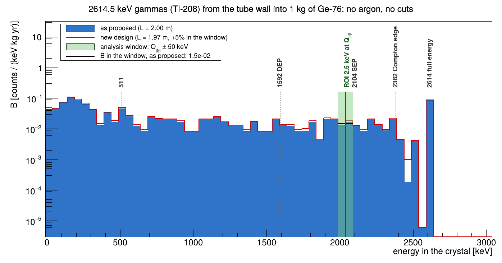
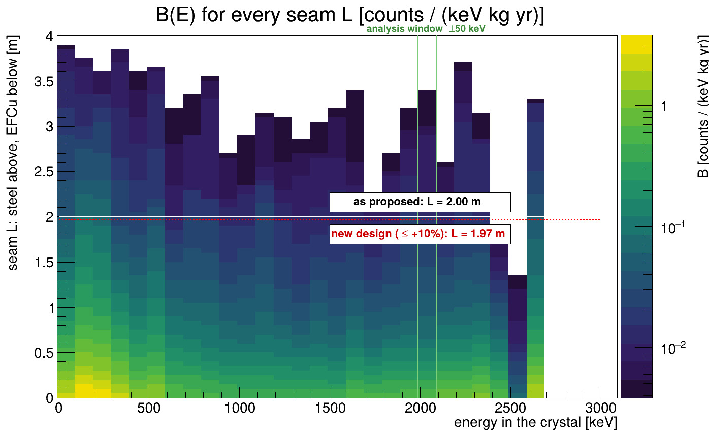

# A tube study in miniature

An exercise: build from nothing a small simulation that answers one question with the main study's method ([README](../README.md)).

**The question:** a tube around a germanium crystal is clean copper (EFCu) below and steel above. Steel is cheaper but
far more radioactive. How far down can the steel come before the background at `Qββ` rises by more than 10%?

## 1. Build it

| Step | File | What you write |
|---|---|---|
| The world | `toygeom.gdml` | a 4 m tube, 1 cm wall, in two pieces (EFCu 0–2 m, steel 2–4 m), a 1 kg Ge-76 crystal at the bottom, vacuum around |
| The source | `toysim.mac` | the 2614 keV gamma of Tl-208 (the strongest gamma above `Qββ` = 2039 keV), started uniformly in one piece, random direction; one run per piece, each with its own number of gammas |
| What to keep | `toysim.mac` | for each gamma: where it started (z) and the energy it left in the crystal |
| The analysis | `toyana.C` | weight, reweight and scan (step 2) |

## 2. The method

1. **Count where it matters.** 0νββ would show as a line at `Qββ` = 2039 keV, inside the **ROI** (2.5 keV wide).
   Too few hits fall in 2.5 keV, so the background is counted in the **analysis window**, `Qββ` ± 50 keV, where it is
   flat: B = counts a year in the window ÷ (100 keV × crystal mass). The background in the ROI is then B × 2.5 keV.
2. **Weight.** One simulated gamma stands for `w` real gammas a year:
   `w` = piece mass × Th-232 chain activity × share of decays that give this gamma × 1 yr ÷ gammas simulated in that piece.
3. **Reweight.** A gamma's path barely depends on whether the wall is copper or steel. So moving the seam keeps every hit
   and only changes `w`: one simulation tests every seam.
4. **Scan.** Move the seam down from 2 m (the tube as proposed), 1 cm at a time. For each seam:
   - the **rise** is how much the window's counts a year go up compared with the tube as proposed, with its error;
   - it **passes** if rise + error ≤ 10%, **fails** if rise − error > 10%, and otherwise the statistics **can't tell**.

The 10% (`tol`) is a design choice, as in the main study. Never derive it from the statistics: fewer gammas would loosen it.

## 3. Run it (a first batch, about 3 min)

```bash
cd ~/Documents/LEGEND1000-Simulation
```

```bash
remage -q --ignore-warnings -t 10 -w -o tut/toyoutput/toy_efcu.root -g tut/toygeom.gdml -s VOL=wall_efcu -s NEV=8000000 -s SEED=1 -- tut/toysim.mac
```

```bash
remage -q --ignore-warnings -t 10 -w -o tut/toyoutput/toy_ss.root -g tut/toygeom.gdml -s VOL=wall_ss -s NEV=14000000 -s SEED=2 -- tut/toysim.mac
```

```bash
root -l -b -q tut/toyana.C
```

## 4. How many gammas? Let the answer decide

- The answer lies in a band: between the lowest seam that passes and the highest that fails.
- If the band is wider than you need (`dRes`, 2 cm), raise `NEV` and run again. `toyana.C` ends by saying which.
- Grow the run the printout names: it splits the error between the copper run and the steel run.

| Gammas (copper / steel) | Hits in the window | Passes down to | Fails from | Band | Verdict |
|---|---|---|---|---|---|
| 72 M / 14 M | 1466 / 7 | 1.97 m (+5.5 ± 4.4%) | 1.89 m | 8 cm | not resolved: 71% of the error from copper |

Counting only in the window keeps 2% of the copper hits and 7 of the 289 steel hits, so it needs far more gammas
than counting at all energies. **So far:** the steel can come down to between 1.97 and 1.89 m. Narrowing the band
4× needs about 16× more gammas, since the error falls as 1 ÷ √gammas.

## 5. Read the plots (72 M / 14 M run)



B is counts per keV, per kg of Ge, per year: blue is the tube as proposed, red the new design. The green band is
the analysis window, the black line in it B as proposed (1.5 × 10⁻²), the dark-green line the ROI at `Qββ`. In the
ROI that is 1.5 × 10⁻² × 2.5 keV × 1 kg ≈ 0.04 counts a year.

- **2614 keV:** the gamma left all its energy.
- **2382 keV:** the Compton edge, the most one scatter can leave.
- **2104 and 1592 keV:** the gamma made an electron–positron pair, and one or both 511 keV photons escaped.
- **The rest, `Qββ` included:** gammas that scattered and left only part of their energy: the background that matters.



Each row is one seam height L, the green lines the analysis window. Lower seams put more steel closer to the crystal,
so the rows get brighter.
