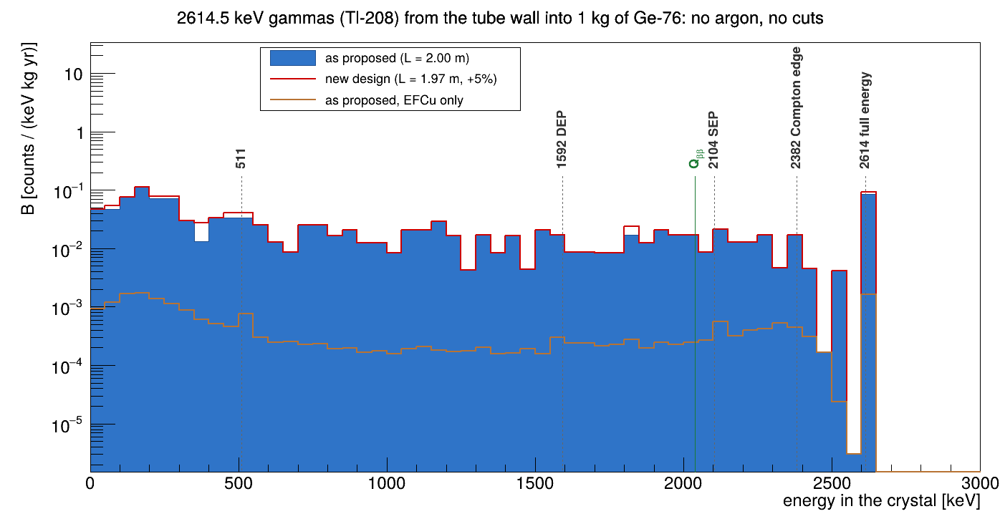
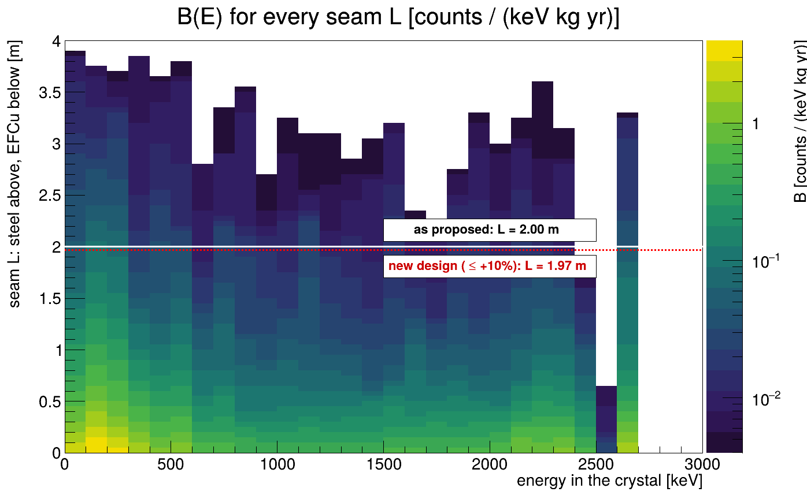

# Weighting and reweighting, in miniature

A miniature version of the tube study, run with the same tools: geometry in GDML, Geant4 transport in remage, and weighting
in a ROOT macro. No Python. The simulation takes about 2.5 min on 10 threads, the analysis about 5 s.

| File | What it is |
|---|---|
| `toy.gdml` | the geometry: a 4 m tube and a 1 kg Ge crystal |
| `toy.mac` | the remage source: 2614.5 keV gammas, uniform in one section of the wall |
| `toy.C` | weight, reweight, scan the seam, plot |

## The setup

- **Tube:** 4 m tall, inner radius 25 cm, 1 cm wall. Steel 316L on top (2–4 m, density 8.0 g/cm³) and EFCu below (0–2 m,
  8.96 g/cm³). Both materials are copied from `geom/l1000geom/l1000.gdml`.
- **Detector:** one crystal of 1 kg of enriched germanium (90% Ge-76, 5.55 g/cm³; radius 30.61 mm, height 61.22 mm). It sits
  on the axis with its bottom face at z = 0.
- **No argon:** the tube and the world are vacuum.
- **Source:** only the 2614.5 keV gamma of Tl-208 (`/gps/particle gamma`, `/gps/energy 2614.511 keV`), isotropic, uniform in
  the wall. There is no beta and no other Tl-208 gamma.
- **Activities:** the Th-232 chain activity as in `ana/ana.C` is EFCu 0.37 µBq/kg (LEGEND-1000 CDR, Table XVII) and steel
  1000 µBq/kg (RT MaterialMix). The 2614.5 keV gamma comes in 35.94% × 99.755% of chains.
- **No cuts, no analysis window, no detector response:** each hit is the raw energy Geant4 leaves in the crystal.

The question: how far down can the seam move, turning EFCu into steel, before the counts a year rise by more than 10%?

## The steps

1. **Simulate.** Run remage once per section, because each section needs a different number of gammas. A steel gamma starts
   2–4 m from the crystal, so 14 M steel gammas give only 289 hits; 8 M EFCu gammas give 7547. For each gamma that leaves
   energy in the crystal, remage records that energy (table `ge`) and the height `z` where the gamma started (table `vtx`).
2. **Weight.** Run r threw N_r gammas through a section of volume V. If that section were material m, it would emit
   ρ_m A_m V gammas a second, where A_m is the 2614.5 keV gamma activity per kg. So one simulated gamma stands for
   w = ρ_m A_m V t_yr / N_r real gammas a year.
3. **Reweight.** A seam at L makes the wall EFCu below L and steel above it. The hits and their `z` stay the same; only w
   changes. Each design is one sum, Σ w, with statistical error √(Σ w²).
4. **Scan.** Move the seam down from 2 m in 1 cm steps, and keep the lowest seam whose counts rise by at most 10%.
5. **Plot.** B(E) in counts/(keV kg yr), for the tube as proposed and for the new design. A heat map shows B(E) for every
   seam L from 0 to 4 m.

## Run

```bash
cd ~/Documents/LEGEND1000-Simulation
```

```bash
remage -q --ignore-warnings -t 10 -w -o output/output_root/toy_efcu.root -g tut/toy.gdml -s VOL=wall_efcu -s NEV=8000000 -s SEED=1 -- tut/toy.mac
```

```bash
remage -q --ignore-warnings -t 10 -w -o output/output_root/toy_ss.root -g tut/toy.gdml -s VOL=wall_ss -s NEV=14000000 -s SEED=2 -- tut/toy.mac
```

```bash
root -l -b -q tut/toy.C
```

The two remage files (164 MB and 279 MB) go to `output/output_root`, which links to `~/Downloads/output_root`, outside iCloud.
The plots go to `output/`.

## Result

| Seam L [m] | EFCu [kg] | Counts a year | Change |
|---|---|---|---|
| 2.00 (as proposed) | 287.1 | 61.0 ± 3.5 | 0% |
| 1.97 (new design) | 282.8 | 64.3 | +5.3% |
| 1.96 | 281.4 | 67.2 | +10.1% |
| 1.90 | 272.8 | 70.4 | +15.4% |
| 0.90 | 129.2 | 285 | +367% |

- **Answer:** only the top 3 cm of EFCu (4.3 kg) can become steel.
- **Why so little:** steel is about 2700 times more radioactive per kg than EFCu. In the tube as proposed, steel 2 m away still
  gives almost all the counts: the EFCu curve in the B(E) plot sits about 100× below the total.
- **Precision:** the tube as proposed is known to ±5.7%, which is the same size as the 10% step.





## How this maps onto the real study

| Miniature | `sim/sim.mac` and `ana/ana.C` |
|---|---|
| 2614.5 keV gammas only | whole Tl-208 and Bi-214 decays |
| 4 m tube, 1 cm wall, two materials | the real tube from `l1000.gdml`: EFCu, Cu and steel, two seams |
| one 1 kg crystal, vacuum | 336 ICPCs in liquid argon |
| raw energy, no cuts | response (`sim/hit.py`), then M1, LAr veto and A/E in the analysis window |
| hits reused, only w changes | the same, per decay by its depth |
| 10% rule on all counts | 10% rule on the BI after all cuts |
