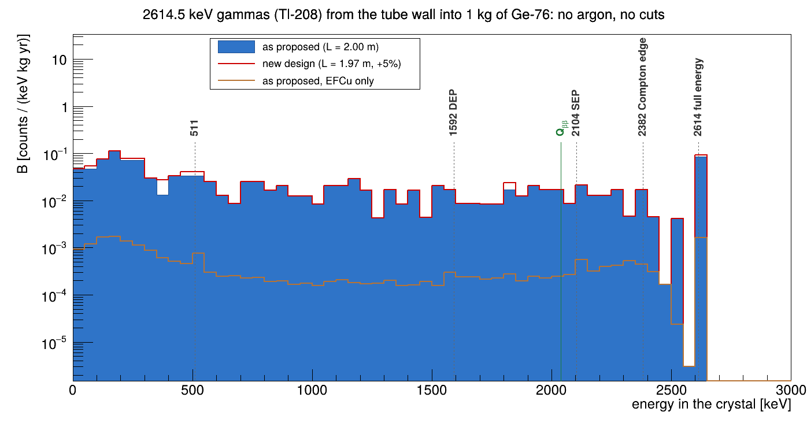
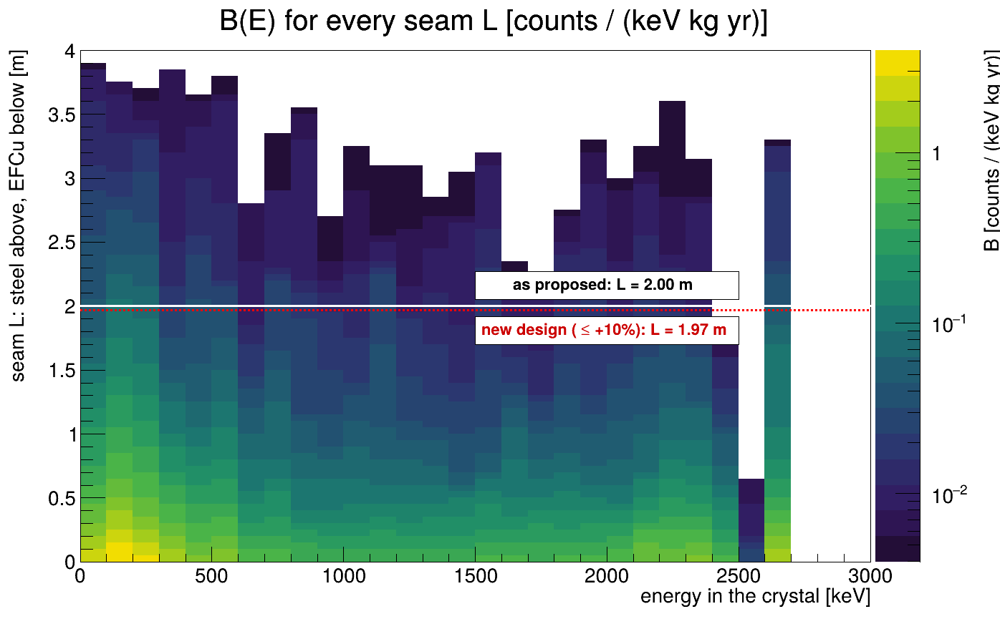

# The tube study in miniature

**Question:** steel is cheaper than clean copper (EFCu), but far more radioactive. How much of a tube's copper can become
steel before the detector sees more than 10% more counts a year?

## The setup

- A 4 m tube with a 1 cm wall: steel on top (2–4 m), EFCu below (0–2 m).
- A 1 kg germanium crystal (Ge-76) on the floor, in the middle. No argon.
- The radioactivity: only the 2614 keV gamma of Tl-208, starting anywhere in the wall and going in any direction.
- Steel has 2700× more of it per kg than EFCu.

## The code

| File | What it does |
|---|---|
| `toygeom.gdml` | builds the tube and the crystal, with real materials |
| `toysim.mac` | tells remage (Geant4) to shoot the gammas from one part of the wall and record what the crystal sees |
| `toyana.C` | turns simulated gammas into real counts a year, tries every seam, and draws the plots |

## Run it (about 2.5 min)

```bash
cd ~/Documents/LEGEND1000-Simulation
```

```bash
remage -q --ignore-warnings -t 10 -w -o tut/toyoutput/toy_efcu.root -g tut/toygeom.gdml -s VOL=wall_efcu -s NEV=8000000 -s SEED=1 -- tut/toysim.mac
```

```bash
remage -q --ignore-warnings -t 10 -w -o tut/toyoutput/toy_ss.root -g tut/toygeom.gdml -s VOL=wall_ss -s NEV=14000000 -s SEED=2 -- tut/toysim.mac
```

```bash
root -l -b -q tut/toyana.C
```

## How it works

1. **Simulate once.** We send 8 M gammas from the copper and 14 M from the steel. For each gamma that reaches the crystal,
   we keep its energy and the height it started from.
2. **Weight.** One simulated gamma stands for `w` real gammas a year, where `w` = (how radioactive the material is) ×
   (how much of it there is) ÷ (how many gammas we simulated).
3. **Reweight.** Moving the seam only changes which material sits at each height, and so only changes `w`. The hits stay the
   same, so every new design is just a new sum, not a new simulation.
4. **Scan.** We move the seam down 1 cm at a time and keep the lowest one that adds at most 10%.

## Results

| Seam | Copper | Counts a year | Change |
|---|---|---|---|
| 2.00 m (as proposed) | 287 kg | 61 ± 3.5 | 0% |
| **1.97 m (new design)** | 283 kg | 64 | +5% |
| 1.96 m | 281 kg | 67 | +10.1%: too much |

**Answer:** only the top 3 cm of copper can become steel. Even 2 m away, the steel gives almost all the counts.

**Energy spectrum.** B is counts per keV, per kg of germanium, per year. The tall line at 2614 keV is the gamma's full energy;
everything below it is gammas that scattered and left only part of their energy. The brown line is the copper alone, about
100× below the total.



**Every seam at once.** Each row is one seam height L, and the colour is B. Lower seams mean more steel near the crystal, so
the colours get brighter.



## Outputs in `toyoutput/`

| File | What it is |
|---|---|
| `toy_efcu.root`, `toy_ss.root` | remage's raw hits (164 MB and 279 MB) |
| `toy_background.png` | the energy spectrum |
| `toy_heatmap.png` | the heat map |
